# MAVE V2 — SYSTEM ARCHITECTURE SPECIFICATION

## 1. HIGH-LEVEL ARCHITECTURAL TOPOLOGY

MAVE V2 is structured into 8 modular architectural tiers designed for high-performance, local-first personal computing and multi-device coordination:

```mermaid
flowchart TB
    subgraph PresentationTier["1. Presentation & Tactile Layer"]
        Island["Dynamic Island HUD (island.html / island.js)"]
        Mascot["Vorssaint Mascot Rig (mascot_rig.js)"]
        Canvas["Chat & Workspace Canvas (home.js / app.html)"]
        Overlay["Transparent Annotation Overlays"]
    end

    subgraph SecurityTier["2. Security, Identity & DPAPI Layer"]
        DPAPI["Electron safeStorage (Windows DPAPI)"]
        UserManager["User & Tenant Manager (users.js)"]
        RBAC["Role-Based Access Control (Owner / Admin / Member / Guest)"]
        Vault["Scoped Credential Vault (credential_vault.js)"]
    end

    subgraph MemoryTier["3. Multi-Tenant Memory & Knowledge Tier"]
        WorkingMem["Short-Term Working Context (agent.js)"]
        UserMemory["Partitioned Fact Store (%APPDATA%/mave/users/{userId}/memory.json)"]
        UserKG["Partitioned Knowledge Graph (%APPDATA%/mave/users/{userId}/kg.json)"]
        NeuralVault["Local BM25 / HNSW Document Vault"]
    end

    subgraph AutonomousTier["4. Autonomous Agent & Coordination Engine"]
        ReAct["ReAct Reasoning Loop (agent.js)"]
        GoalDAG["Topological Goal DAG Planner (goal_graph.js)"]
        Reflexion["Self-Correcting Reflexion Engine (reflexion_engine.js)"]
        Auditor["Fresh Context Action Auditor (fresh_auditor.js)"]
        SkillRegistry["Procedural Skill Registry (skills/registry.js)"]
    end

    subgraph LocalInferenceTier["5. Local Multimodal AI Inference Tier"]
        Router["Hardware-Aware Model Router (local/router.js)"]
        VulkanLLM["llama-server.exe (b11276 Vulkan) -> Qwen3-VL 8B"]
        ColibriMoE["Colibri Engine -> DeepSeek-V4-Flash / Qwen3.6-35B"]
        WhisperSTT["whisper-server.exe -> Whisper Base English STT"]
        KokoroTTS["onnxruntime-node -> Kokoro 82M v1.0 TTS"]
        Pix2TextOCR["onnxruntime-node -> Pix2Text MFR 1.5 Math OCR"]
        CloudFallback["Optional Authorized Cloud LLMs (Claude / GPT-4o)"]
    end

    subgraph AutomationTier["6. OS & Isolated Browser Automation Tier"]
        InputHelper["Native C# Helper (Win32 SendInput & UI Automation)"]
        SessionGuard["Desktop Session 1 Lock Detector (computer.js)"]
        BrowserPool["Headless Browser Worker Pool (Playwright / CDP)"]
        TerminalConPTY["Virtual ConPTY Terminals (@lydell/node-pty)"]
    end

    subgraph ConnectivityTier["7. Connected Mesh & Remote Companion"]
        MeshDiscovery["UDP Multicast Discovery (mesh_discovery.js)"]
        MaveDrop["Authenticated P2P File Transfer (mavedrop.js)"]
        MobileGateway["Express & WebSocket Server (remote/web.js)"]
        CFTunnel["Cloudflare Quick / Named Tunnel (cloudflared.exe)"]
    end

    subgraph ApplianceTier["8. Hardware Appliance Profiles"]
        Crust["MAVE Crust (₹1.6L - Family / 1-2 Inference Slots)"]
        Mantel["MAVE Mantel (₹3.2L - Pro / 3-4 Inference Slots)"]
        Core["MAVE Core (₹9.99L - Enterprise / 6 Autonomous Workers)"]
    end

    PresentationTier <--> SecurityTier
    SecurityTier <--> MemoryTier
    MemoryTier <--> AutonomousTier
    AutonomousTier <--> LocalInferenceTier
    AutonomousTier <--> AutomationTier
    SecurityTier <--> ConnectivityTier
    ConnectivityTier <--> ApplianceTier
```



## 2. SUBSYSTEM CONTRACTS & INTERFACES

### 2.1 Security & Secret Storage Contract
- **Rule:** Plaintext secrets must never be committed to disk, sent to renderer processes, or printed to terminal logs.
- **Implementation:** All sensitive entries are passed through `safeStorage.encryptString()` and stored as base64-encoded ciphertext. Decryption occurs strictly within the Node.js main process.
- **Renderer Protection:** `Settings.publicView()` maps all secrets to boolean presence flags `{ hasAnthropicKey: true, hasOpenaiKey: false }`.

### 2.2 Multi-Tenant Memory Contract
- **Rule:** Data belonging to one user identity (`userId`) must never leak to another user.
- **Directory Structure:**
  ```text
  %APPDATA%/mave/
    ├── settings.json                     (Host machine configuration)
    ├── users/
    │   ├── default/
    │   │   ├── memory.json              (Local desktop user facts)
    │   │   └── knowledge_graph.json     (Local desktop semantic triples)
    │   ├── usr_abc123/
    │   │   ├── memory.json              (Remote user facts)
    │   │   └── knowledge_graph.json     (Remote user semantic triples)
  ```
- **Fallback Compatibility:** If `userId` is omitted, `MemoryStore` defaults safely to `'default'`, ensuring 100% backward compatibility for all existing single-user desktop features and existing test suites.

### 2.3 Automation & Browser Concurrency Contract
- **Problem:** Windows desktop automation (`SendInput`) is a single-seat resource bound to the active physical cursor on Display Session 1.
- **Solution:** 
  1. Desktop OS actions acquire an exclusive session mutex. If the Windows session is locked, actions are paused with a clear user prompt.
  2. Web automation and document scraping are delegated to `BrowserWorker`, which operates inside headless Chromium contexts without interfering with the user's mouse pointer.

### 2.4 Simulation Transparency Contract
- **Rule:** Features lacking live physical hardware connections must report `simulated: true` in their plugin definitions.
- **Implementation:** Tools in `automotive_sentinel.js`, `tapkit_iphone.js`, `cua_sandbox.js`, and `iot_hub.js` append `[SIMULATED DATA]` or `[PROTOTYPE]` badges to outputs, ensuring the AI agent does not hallucinate physical control.

### 2.5 Hardware-Aware Model Routing Contract
- **Telemetry Ingestion:** `router.js` reads GPU VRAM from `nvidia-smi` / registry and available system RAM before assigning a model.
- **Tier Escalation:**
  - Tasks requiring vision or instant action: `Qwen3-VL 8B` (Vulkan Port 8080).
  - Heavy programming and logic: `Qwen3.6-35B` or `DeepSeek-V4-Flash` (Colibri Port 8000).
  - Cloud fallback: Triggered only when authorized by user settings and local execution fails.
