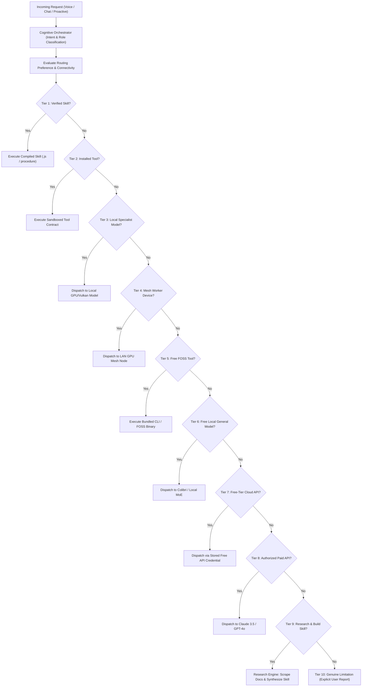
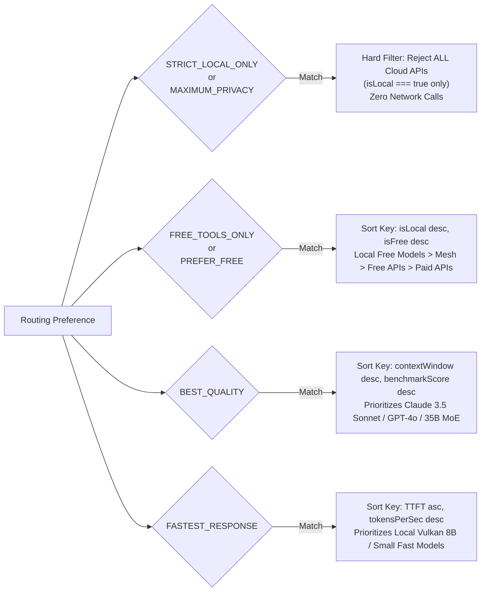

# MAVE CAPABILITY REGISTRY & MULTI-TIER RESOLUTION SPECIFICATION

**Subsystem:** MAVE Cognitive Brain V3 · Capability Registry & Hardware-Aware Dispatcher  
**Implementation Source:** [`src/main/orchestrator/capability_registry.js`](file:///c:/Users/ryzen/Documents/antigravity/dazzling-archimedes/src/main/orchestrator/capability_registry.js)  
**Related Components:** [`src/main/orchestrator/cognitive_orchestrator.js`](file:///c:/Users/ryzen/Documents/antigravity/dazzling-archimedes/src/main/orchestrator/cognitive_orchestrator.js), [`src/main/orchestrator/tool_contract.js`](file:///c:/Users/ryzen/Documents/antigravity/dazzling-archimedes/src/main/orchestrator/tool_contract.js), [`src/main/orchestrator/research_discovery.js`](file:///c:/Users/ryzen/Documents/antigravity/dazzling-archimedes/src/main/orchestrator/research_discovery.js)  
**Governance & Standards:** Gravitas Invariants · Local-First Priority · Zero Silent Fallback · Grounded Capability Execution  

---

## 1. EXECUTIVE SUMMARY & DESIGN PHILOSOPHY

The MAVE Capability Registry serves as the central nervous system for capability discovery, role attribution, and model dispatch within MAVE Brain V3. Rather than relying on rigid, monolithic model bindings or blindly sending user instructions to expensive commercial APIs, MAVE resolves tasks through a deterministic **10-Tier Capability Resolution Hierarchy**.

Every incoming user instruction is decomposed by the cognitive orchestrator into required functional roles (e.g., Coding, Vision, Speech Synthesis, Mathematics), matched against the user's explicit routing preferences (e.g., `prefer_free`, `strict_local_only`, `maximum_privacy`), and evaluated against real-time local hardware capacity.



---

## 2. THE 10-TIER CAPABILITY RESOLUTION HIERARCHY

The resolution ladder is strictly enumerated in `CapabilityTier` (`src/main/orchestrator/capability_registry.js#L5-L16`):

```javascript
const CapabilityTier = {
  VERIFIED_SKILL: 1,
  INSTALLED_TOOL: 2,
  LOCAL_SPECIALIST_MODEL: 3,
  MESH_WORKER_DEVICE: 4,
  FREE_FOSS_TOOL: 5,
  FREE_LOCAL_MODEL: 6,
  FREE_TIER_API: 7,
  AUTHORIZED_PAID_API: 8,
  RESEARCH_AND_BUILD_SKILL: 9,
  GENUINE_LIMITATION: 10,
};
```

### Detailed Tier Specifications

| Tier | Designation | Execution Engine | Resolution Criteria | Failure & Transition Policy |
|---|---|---|---|---|
| **Tier 1** | **Verified Skill** | Built-in JavaScript procedural routines, learned skill procedures in `MemoryDatabase`, and SkillForge modules. | Task description regex or semantic signature matches a verified procedural skill. Zero neural inference required. | If the skill encounters runtime schema errors, falls through to Tier 2 or Tier 3 for adaptive recovery. |
| **Tier 2** | **Installed Tool** | `ToolRegistryAndVerifier` sandboxed tool contracts (e.g., `read_file`, `write_file`, `run_command`, `web_search`). | Direct tool invocation requested or planned by ReAct loop where input parameters pass strict schema validation. | If tool execution fails parameter verification, triggers dynamic replanning. |
| **Tier 3** | **Local Specialist Model** | Dedicated local models running on host GPU/NPU/CPU via `llama-server.exe` (Vulkan) or `onnxruntime-node`. | Subsystem requires dedicated neural specialization: Vision (Qwen3-VL 8B), STT (Whisper Base), TTS (Kokoro 82M), or Math OCR (Pix2Text). | If GPU VRAM is constrained or model crashes, falls to Tier 4 (Mesh) or Tier 6 (CPU fallback). |
| **Tier 4** | **Mesh Worker Device** | LAN-discovered companion devices registered via `registerMeshWorker` (e.g., secondary gaming rig with RTX 5090). | Local hardware is overloaded, offline, or lacks required memory, but authenticated LAN mesh node has advertised capability. | If LAN node pings exceed timeout (>250ms) or drop connection, cascades to Tier 5/6. |
| **Tier 5** | **Free FOSS Tool** | Bundled command-line utilities and system binaries (`ffmpeg`, `pandoc`, `git`, `curl`, `ripgrep`). | User requests media conversion, format transformation, or system operations where a standard CLI utility exists. | If binary is missing, triggers Tier 9 (SkillForge) to auto-download and configure. |
| **Tier 6** | **Free Local General Model** | Large local models or MoE architectures (e.g., Colibri Qwen 3.6 35B, DeepSeek-V4-Flash) via disk-streaming. | General orchestration, heavy reasoning, or code generation requiring larger parameter count without API cost. | If disk streaming throughput (<4 t/s) violates deadline, prompts for Tier 7/8 upgrade. |
| **Tier 7** | **Free-Tier API** | Authenticated cloud endpoints offering non-metered free tiers (e.g., Gemini Free API, HuggingFace Inference Free, Groq Free). | Allowed under `prefer_free` or `balanced` when local models are unavailable or uninstalled and internet is active. | If rate limit (HTTP 429) is received, terminates provider immediately (LR-091) and tries next tier. |
| **Tier 8** | **Authorized Paid API** | Frontier cloud LLMs (Anthropic Claude 3.5 Sonnet, OpenAI GPT-4o) via DPAPI-encrypted user API keys. | Explicit user consent given; user selected `best_quality` or `fastest_response`; or task complexity exceeds local model ceiling. | If quota depleted or unauthorized, halts; NEVER charges user credit autonomously. |
| **Tier 9** | **Research & Build Skill** | Autonomous Research Discovery Engine (`src/main/orchestrator/research_discovery.js`). | No installed tool or model can directly solve the request, but research documentation/APIs can be scraped and codified. | If research engine synthesizes a working script, it is sandbox-verified and elevated to Tier 1. |
| **Tier 10** | **Genuine Limitation** | Formal limitation disclosure via `EvidenceClassification.UNSUPPORTED`. | Task is mathematically impossible, physically unattainable, violates safety boundaries, or lacks host execution rights. | Transparently informs user with exact technical reason; zero hallucinated success claims. |

---

## 3. MODEL AND TOOL METADATA SCHEMA

MAVE Brain V3 enforces strict typing on all registered models, tools, and mesh workers. Unregistered or malformed capabilities cannot be registered or scheduled.

### 3.1 Model Registration Schema

Implemented in `CapabilityRegistry.registerModel(spec)` (`src/main/orchestrator/capability_registry.js#L65-L91`):

```typescript
interface ModelSpecification {
  /** Unique programmatic identifier (e.g., 'qwen3-vl-8b', 'claude-3-5-sonnet') */
  id: string;

  /** Human-readable display name for UI and audio reporting */
  label: string;

  /** Hosting provider: 'local' | 'colibri' | 'anthropic' | 'openai' | 'mesh' */
  provider: 'local' | 'colibri' | 'anthropic' | 'openai' | 'mesh' | string;

  /** Binary or weight source: 'disk' | 'cloud' | 'lan_socket' */
  source?: 'disk' | 'cloud' | 'lan_socket';

  /** Model architecture family: 'transformer' | 'moe' | 'diffusion' | 'onnx' */
  architecture?: string;

  /** Array of supported operational roles (see Section 4) */
  roles: ModelRole[];

  /** Supported I/O modalities: 'text' | 'image' | 'audio' */
  modality: Array<'text' | 'image' | 'audio'>;

  /** Whether the model natively supports JSON/XML tool calling contracts */
  toolCalling: boolean;

  /** Maximum context window size in tokens */
  contextWindow: number;

  /** Licensing terms: 'open-weights' | 'proprietary' | 'commercial' */
  license?: string;

  /** Dedicated GPU VRAM footprint in Gigabytes */
  vramGB: number;

  /** Host RAM footprint in Gigabytes */
  ramGB: number;

  /** Cost in USD per 1,000,000 prompt/input tokens */
  costPerMillionInputTokens?: number;

  /** Cost in USD per 1,000,000 completion/output tokens */
  costPerMillionOutputTokens?: number;

  /** Zero-marginal-cost flag */
  isFree: boolean;

  /** Local execution flag (100% offline, zero network telemetry) */
  isLocal: boolean;

  /** Whether weights are currently present on disk or accessible */
  installed: boolean;

  /** Historical execution success counter */
  successCount?: number;

  /** Historical execution failure counter */
  failureCount?: number;

  /** Epoch timestamp of last verified invocation */
  lastVerificationDate?: number;
}
```

### 3.2 Tool Contract Schema

Implemented in `ToolContract` (`src/main/orchestrator/tool_contract.js#L14-L40`):

```typescript
interface ToolContractSpecification {
  name: string;
  description: string;
  parameters: Record<string, {
    type: 'string' | 'number' | 'boolean' | 'object' | 'array';
    required: boolean;
    description?: string;
  }>;
  executionEnvironment: 'host' | 'guest_vm' | 'isolated_worker';
  requiresConfirmation?: boolean;
  timeoutMs?: number;
}
```

### 3.3 Mesh Worker Specification

Implemented in `CapabilityRegistry.registerMeshWorker(worker)` (`src/main/orchestrator/capability_registry.js#L209-L216`):

```typescript
interface MeshWorkerSpecification {
  id: string;
  label: string;
  ipAddress?: string;
  port?: number;
  roles: ModelRole[];
  vramGB?: number;
  isLocal: false;
  isFree: true;
  installed: boolean;
  latencyMs?: number;
}
```

---

## 4. FUNCTIONAL ROLE DEFINITIONS & HARDWARE MATRIX

The registry divides neural and algorithmic computation into 13 distinct functional roles:

```javascript
const ModelRole = {
  ORCHESTRATION: 'orchestration',
  CODING: 'coding',
  COMPLEX_REASONING: 'complex_reasoning',
  RESEARCH: 'research',
  VISION: 'vision',
  SPEECH_RECOGNITION: 'stt',
  SPEECH_SYNTHESIS: 'tts',
  MATHEMATICS: 'math',
  IMAGE_GENERATION: 'image_gen',
  DOCUMENT_UNDERSTANDING: 'doc_understanding',
  EMBEDDINGS: 'embeddings',
  RERANKING: 'reranking',
  VERIFICATION: 'verification',
};
```

### Role Operational Criteria & Baseline Allocations

| Role Identifier | Description & Responsibility | Primary Assigned Engine | Min VRAM | Min RAM | Target Execution Engine |
|---|---|---|---|---|---|
| `orchestration` | High-level goal decomposition, cognitive event routing, ReAct loop coordination. | Qwen3-VL 8B / Claude 3.5 | 6.0 GB | 8.0 GB | `llama-server.exe` (Vulkan) |
| `coding` | Code generation, bug refactoring, unit test generation, AST manipulation. | Qwen3-VL 8B / Claude 3.5 Sonnet | 6.0 GB | 8.0 GB | Specialist Coding Orchestrator |
| `complex_reasoning` | Formal proofs, multi-step planning, systems architecture, algorithmic search. | Colibri Qwen 3.6 35B / DeepSeek | 4.0 GB | 24.0 GB | Colibri Disk/RAM Streamer |
| `research` | Deep web documentation scraping, paper synthesis, citation validation. | Research Discovery Engine | 0 GB | 4.0 GB | Node.js Worker + Headless Browser |
| `vision` | UI screenshot perception, visual grounding, element bounding box extraction. | Qwen3-VL 8B Instruct | 6.8 GB | 8.0 GB | Vulkan MMProj (`b11276`) |
| `stt` | Streaming audio transcription, offline speech boundary detection. | Whisper Base English (74M) | 0 GB | 1.0 GB | `whisper-server.exe` (CPU AVX2) |
| `tts` | Lifelike conversational speech generation, phonemizer synthesis. | Kokoro 82M v1.0 | 0 GB | 1.0 GB | `onnxruntime-node` (CPU AVX2) |
| `math` | Formula recognition, handwritten fraction extraction, LaTeX/MathML conversion. | Pix2Text MFR 1.5 (45M) | 0 GB | 1.0 GB | `onnxruntime-node` (CPU AVX2) |
| `doc_understanding` | PDF parsing, multi-column layout detection, scanned OCR table extraction. | Qwen3-VL 8B / Local Tesseract | 6.0 GB | 4.0 GB | Vulkan / Worker Process |
| `embeddings` | Semantic search, episodic memory indexing, vector generation. | MiniLM-L6-v2 / BGE-small | 0 GB | 1.0 GB | `onnxruntime-node` |
| `reranking` | Memory retrieval candidate reordering, precision context ranking. | BGE-Reranker-base | 0 GB | 2.0 GB | `onnxruntime-node` |
| `verification` | Independent post-execution deliverable auditing (Fresh Context Auditor). | Claude 3.5 Sonnet / Qwen3 8B | 6.0 GB | 8.0 GB | Isolated Sandboxed Worker |
| `image_gen` | Mascot emotion rendering, diagram generation, visual asset generation. | SD 1.5 / Local Canvas Engine | 4.0 GB | 8.0 GB | DirectML / Vulkan Pipeline |

---

## 5. USER ROUTING PREFERENCES & POLICY RESOLUTION

Users configure their routing preference either globally via settings or dynamically per-session. The registry natively supports 8 operational preference modes:

```javascript
const RoutingPreference = {
  STRICT_LOCAL_ONLY: 'strict_local_only',
  FREE_TOOLS_ONLY: 'free_tools_only',
  PREFER_FREE: 'prefer_free',
  BALANCED: 'balanced',
  BEST_QUALITY: 'best_quality',
  FASTEST_RESPONSE: 'fastest_response',
  MAXIMUM_PRIVACY: 'maximum_privacy',
  CUSTOM: 'custom',
};
```

### Preference Execution Policies



1. **`strict_local_only`:**
   - **Constraint:** Hard rejection of any capability where `isLocal !== true`.
   - **Offline Guarantee:** Guaranteed to function with zero active internet connection.
   - **Failure Behavior:** If a capability cannot be satisfied locally, returns Tier 9 or Tier 10 immediately without querying external networks.
2. **`free_tools_only`:**
   - **Constraint:** Hard rejection of any capability where `isFree !== true`.
   - **Monetary Invariant:** User token billing is mathematically guaranteed to be $0.00.
3. **`prefer_free` (MAVE Default):**
   - **Constraint:** Resolves locally installed free models first. If unavailable, falls through to LAN mesh workers, free-tier APIs, and only prompts for paid APIs if explicitly permitted.
4. **`maximum_privacy`:**
   - **Constraint:** Treats prompt data, audio transcripts, and screen observations as confidential biometric/user assets. All inference must remain on local silicon (CPU/GPU) or cryptographically verified zero-logging enterprise endpoints.
5. **`best_quality`:**
   - **Constraint:** Ranks models by reasoning benchmarks and context window depth (e.g., Claude 3.5 Sonnet 200k, Colibri Qwen 35B 32k). Used for complex software refactoring and formal mathematical proofs.
6. **`fastest_response`:**
   - **Constraint:** Prioritizes Time-to-First-Token (TTFT) and token streaming speed (e.g., Qwen3-4B at 52-64 t/s or Qwen3-VL 8B at 320ms TTFT). Crucial for voice conversation loops.
7. **`balanced`:**
   - **Constraint:** Uses fast local models for interactive conversation and planning; delegates heavy code compilation or deep research to specialist workers.
8. **`custom`:**
   - **Constraint:** User-defined JSON routing table mapping specific roles or task regexes to designated model IDs.

---

## 6. RESOLUTION ALGORITHM & CANDIDATE RANKING

The core resolution method `resolveBestCapability(query)` (`src/main/orchestrator/capability_registry.js#L227-L293`) evaluates candidate capabilities through a four-phase pipeline:

### Phase 1: Verified Skill Match (Deterministic Bypass)
Checks all in-memory and persisted skills. If `skill.matchPattern.test(query.task)` succeeds, returns Tier 1 (`CapabilityTier.VERIFIED_SKILL`) with zero neural latency.

### Phase 2: Role, Modality & Tool-Calling Invariant Filtering
Eliminates all registered models that violate operational preconditions:
- Target model must contain `query.requiredRole` in `model.roles`.
- If `query.requiredModality` is specified (e.g., `image`), target model must support that modality.
- If `query.requiresToolCalling === true`, target model must have `toolCalling === true`.
- If `query.online === false`, target model must have `isLocal === true`.
- If routing preference is `STRICT_LOCAL_ONLY`, non-local models are purged.
- If routing preference is `FREE_TOOLS_ONLY`, non-free models are purged.

### Phase 3: Multi-Criteria Dynamic Candidate Sorting
The surviving candidate pool is ranked using composite scoring:

$$\text{Score}(M) = W_{\text{loc}} \cdot I_{\text{local}} + W_{\text{free}} \cdot I_{\text{free}} + W_{\text{ctx}} \cdot \log_2(\text{Ctx}) + (\text{Successes} - 2 \cdot \text{Failures})$$

- Under `PREFER_FREE` or `MAXIMUM_PRIVACY`, local and free flags dominate ($W_{\text{loc}} = 1000, W_{\text{free}} = 500$).
- Under `BEST_QUALITY`, context window and benchmark ratings dominate.
- Installed models on disk receive an immediate priority boost over uninstalled models.
- Execution history penalty: Every recorded failure subtracts 2 points from the model's historical reliability score.

### Phase 4: Tier Assignment & Feedback Tracking
Assigns the selected candidate to its exact tier:
- If target is local and free: `LOCAL_SPECIALIST_MODEL` (Tier 3) or `FREE_LOCAL_MODEL` (Tier 6).
- If target is cloud and free: `FREE_TIER_API` (Tier 7).
- If target is cloud and paid: `AUTHORIZED_PAID_API` (Tier 8).
- If candidate pool is empty: Returns `RESEARCH_AND_BUILD_SKILL` (Tier 9) to invoke the autonomous discovery engine.

---

## 7. AUTOMATED HEALTH TRACKING & SELF-HEALING FEEDBACK LOOP

The registry maintains an operational audit trail on each registered model via `recordTaskOutcome(modelId, success)`:
1. **Dynamic Circuit Breaker:** If a model accumulates 3 consecutive runtime failures (e.g., memory exhaustion, CUDA illegal memory access, API timeout), its composite score drops below alternative tiers.
2. **Terminal Rate-Limit Isolation (LR-091):** If a cloud provider returns HTTP 429 (rate-limited), it is marked terminal for the remainder of the session and never polled in a retry loop.
3. **Audited Deliverables:** When a coding or reasoning task finishes, the outcome is verified against the `GoalContract` deliverables before incrementing `successCount`.

This guarantees that MAVE continuously adapts to host degradation, driver crashes, network drops, and API quota exhaustion without freezing or degrading user experience.
