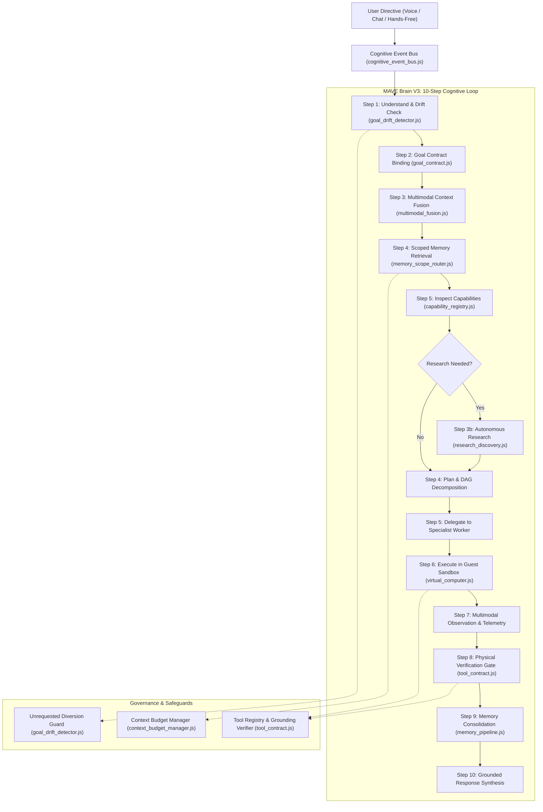

# MAVE Brain V3 — Cognitive Orchestration Architecture Specification

## 1. Executive Summary & Paradigm Shift

MAVE Brain V3 marks an architectural departure from the fragile **prompt-stuffed, single-turn LLM agent loop** toward a deterministic, verifiable **10-Step Cognitive Orchestration Engine**.

In legacy autonomous systems (including MAVE V1 and V2), the runtime relied on stuffing thousands of tokens of tool descriptions, system prompts, operational rules, and open-ended background context into an LLM's system prompt ([`src/main/prompt.js`](file:///c:/Users/ryzen/Documents/antigravity/dazzling-archimedes/src/main/prompt.js)). The model was then prompted to reason, plan, and call tools in a single open-ended ReAct loop ([`src/main/agent.js`](file:///c:/Users/ryzen/Documents/antigravity/dazzling-archimedes/src/main/agent.js)). This produced well-documented failure modes:
1. **Attention Dilution & Instruction Drift:** Local quantized models (e.g., 8B parameter models on desktop GPUs) succumbed to attention saturation, neglecting negative constraints and wandering into unrequested applications.
2. **Hallucination of Completion:** The LLM routinely asserted that tasks were completed without executing tools or verifying filesystem state.
3. **Context Window Exhaustion:** Unscoped memory retrievals polluted coding tasks with unrelated household or personal memories, blowing past KV-cache limits.
4. **State Amnesia on Interruption:** User conversational interruptions (e.g., "How's it going?") frequently derailed active execution DAGs.

MAVE Brain V3 replaces this with a decoupled cognitive pipeline implemented in [`src/main/orchestrator/cognitive_orchestrator.js`](file:///c:/Users/ryzen/Documents/antigravity/dazzling-archimedes/src/main/orchestrator/cognitive_orchestrator.js). Execution is strictly governed by structured state contracts ([`GoalContract`](file:///c:/Users/ryzen/Documents/antigravity/dazzling-archimedes/src/main/orchestrator/goal_contract.js)), typed tool verification ([`ToolContract`](file:///c:/Users/ryzen/Documents/antigravity/dazzling-archimedes/src/main/orchestrator/tool_contract.js)), 10-tier capability resolution ([`CapabilityRegistry`](file:///c:/Users/ryzen/Documents/antigravity/dazzling-archimedes/src/main/orchestrator/capability_registry.js)), bounded token budgets ([`ContextBudgetManager`](file:///c:/Users/ryzen/Documents/antigravity/dazzling-archimedes/src/main/memory/context_budget_manager.js)), and scoped memory isolation ([`MemoryScopeRouter`](file:///c:/Users/ryzen/Documents/antigravity/dazzling-archimedes/src/main/memory/memory_scope_router.js)).

---

## 2. System Architecture Topology

The cognitive orchestration layer coordinates user directives across memory, reasoning models, isolation sandboxes, and verification gates:

---

## 3. The 10-Step Cognitive Loop

MAVE Brain V3 processes every user interaction through an invariant 10-step sequence inside [`MaveCognitiveOrchestrator.handleUserInteraction`](file:///c:/Users/ryzen/Documents/antigravity/dazzling-archimedes/src/main/orchestrator/cognitive_orchestrator.js#L84-L270):

### Step 1: Understand (Goal Intake & Drift Check)
- **Component:** [`GoalDriftDetector`](file:///c:/Users/ryzen/Documents/antigravity/dazzling-archimedes/src/main/orchestrator/goal_drift_detector.js)
- **Operation:** When input arrives, if an active task exists, the detector classifies the incoming utterance into one of six distinct categories before allowing model intervention:
  - `STATUS_REQUEST`: Evaluated via regex/semantic patterns (e.g., *"how's it going?"*, *"what are you doing?"*). Returns an instant telemetry progress summary without mutating task state or invoking tools.
  - `TASK_PAUSE` / `TASK_RESUME`: Safely suspends or reactivates active worker loops without data loss.
  - `EMERGENCY_STOP`: Immediately transitions active tasks to `TaskStatus.CANCELLED` and clears the active task slot.
  - `CORRECTION`: Refines the confirmed objective (`clarifyObjective`) while keeping the immutable `originalRequest` intact for compliance auditing.
  - `NEW_TASK`: Unrelated goals are automatically directed to `taskQueue` rather than corrupting the active execution workspace.
  - `TASK_CONTINUATION`: Routine multi-turn conversational progression.

### Step 2: Goal Contract Binding
- **Component:** [`GoalContract`](file:///c:/Users/ryzen/Documents/antigravity/dazzling-archimedes/src/main/orchestrator/goal_contract.js)
- **Operation:** Fresh requests bind to a strongly-typed `GoalContract`. Key invariant: `this.originalRequest` is wrapped in `Object.freeze()`. All mutations, phase transitions, and subtasks are tracked in `executionHistory`. Checkpoints can be durably written to disk via `saveCheckpoint()`.

### Step 3: Multimodal Context Fusion
- **Component:** [`MultimodalFusionEngine`](file:///c:/Users/ryzen/Documents/antigravity/dazzling-archimedes/src/main/multimodal/multimodal_fusion.js)
- **Operation:** Merges raw text prompts with ambient visual signals:
  - Screen window hierarchy (`ScreenAwarenessService`).
  - Active focused application context.
  - Spatial camera telemetry (`CameraAwarenessService`), with biometric exclusions and privacy filters.

### Step 4: Scoped Memory Retrieval
- **Component:** [`MemoryScopeRouter`](file:///c:/Users/ryzen/Documents/antigravity/dazzling-archimedes/src/main/memory/memory_scope_router.js) & [`MemoryPipeline`](file:///c:/Users/ryzen/Documents/antigravity/dazzling-archimedes/src/main/memory/memory_pipeline.js)
- **Operation:** Rather than dumping all user memories into the prompt, the query is classified into a strict `ScopeCategory` (`CODING_PROJECT`, `USER_PREFERENCES`, `DEVICE_TELEMETRY`, `PERSON_DIRECTORY`, `PROCEDURAL_SKILL`, `GENERAL_SEMANTIC`).
- **Isolation Enforcement:** A coding query retrieves strictly from the `coding` and `project_knowledge` namespaces. Unrelated namespaces (such as `personal_life`, `household`, or `camera_observations`) are explicitly prohibited.

### Step 5: Inspect Capabilities & Model Routing
- **Component:** [`CapabilityRegistry`](file:///c:/Users/ryzen/Documents/antigravity/dazzling-archimedes/src/main/orchestrator/capability_registry.js)
- **Operation:** Queries are evaluated against available models and tools along a 10-tier capability hierarchy:
  1. `VERIFIED_SKILL` (Pre-compiled, deterministic procedures)
  2. `INSTALLED_TOOL` (Registered, sandboxed tool contracts)
  3. `LOCAL_SPECIALIST_MODEL` (Local GPU-accelerated models: Qwen3-VL 8B, Colibri 35B)
  4. `MESH_WORKER_DEVICE` (Authorized LAN cluster nodes, e.g., RTX 5090 rig)
  5. `FREE_FOSS_TOOL` (Local CLI utilities, e.g., FFmpeg, Pandoc)
  6. `FREE_LOCAL_MODEL` (CPU/quantized local models)
  7. `FREE_TIER_API` (Free-tier cloud endpoints)
  8. `AUTHORIZED_PAID_API` (Claude 3.5 Sonnet, GPT-4o)
  9. `RESEARCH_AND_BUILD_SKILL` (Autonomous procedure synthesis via `ResearchDiscoveryEngine`)
  10. `GENUINE_LIMITATION` (Clear, honest capability boundary reporting)
- Model selection aligns with active user preference: `PREFER_FREE`, `STRICT_LOCAL_ONLY`, `MAXIMUM_PRIVACY`, or `BEST_QUALITY`.

### Step 6: Research if Needed (Autonomous Discovery)
- **Component:** [`ResearchDiscoveryEngine`](file:///c:/Users/ryzen/Documents/antigravity/dazzling-archimedes/src/main/orchestrator/research_discovery.js)
- **Operation:** If an objective lacks a verified skill or installed tool, MAVE initiates an evidence-based research probe. The engine inspects official documentation, package registries, or video tutorial transcripts (`extractProcedureFromTranscript`), extracting procedural steps into executable workflows.

### Step 7: Plan & Delegate to Specialist Worker
- **Component:** [`CodingAgentOrchestrator`](file:///c:/Users/ryzen/Documents/antigravity/dazzling-archimedes/src/main/orchestrator/coding_agent.js) & Specialist Worker Pool
- **Operation:** The objective is mapped into discrete subtasks. If classified as a software engineering task (`isCodingTask`), execution is delegated to the `CodingAgentOrchestrator`, which manages project workspace initialization, scaffolding, file creation, and local compilation.

### Step 8: Execute in Isolated Guest Sandbox
- **Component:** [`VirtualComputerSession`](file:///c:/Users/ryzen/Documents/antigravity/dazzling-archimedes/src/main/virtual_computer.js) & [`ToolContract`](file:///c:/Users/ryzen/Documents/antigravity/dazzling-archimedes/src/main/orchestrator/tool_contract.js)
- **Operation:** Tool operations (`write_file`, `read_file`, `run_command`, `web_search`) execute inside isolated guest workspaces. Every tool call undergoes pre-execution parameter validation via `ToolContract.validateArgs(args)`.

### Step 9: Observe & Verify (Physical Acceptance Gate)
- **Component:** [`ToolRegistryAndVerifier`](file:///c:/Users/ryzen/Documents/antigravity/dazzling-archimedes/src/main/orchestrator/tool_contract.js#L171-L264)
- **Operation:** The system validates that all claimed deliverables physically exist on the filesystem (`verifyDeliverableGrounding`).
- If an LLM states that it created a website or fixed a bug, but no successful `write_file` record exists and the file does not exist on disk, verification fails (`verificationStatus = 'FAILED'`). The task is marked `TaskStatus.FAILED`. **Zero false completion is allowed.**

### Step 10: Learn & Respond
- **Component:** [`MemoryPipeline.processTurnForLearning`](file:///c:/Users/ryzen/Documents/antigravity/dazzling-archimedes/src/main/memory/memory_pipeline.js)
- **Operation:**
  1. Learnings, user corrections, and successful procedures are distilled and stored into SQLite memory tables (`storeFact`, `storeProcedure`). Contradictions are resolved in place by entity key.
  2. The response is composed strictly from verified tool evidence and artifacts.
  3. `FINAL_RESPONSE_DELIVERED` event is emitted on the [`CognitiveEventBus`](file:///c:/Users/ryzen/Documents/antigravity/dazzling-archimedes/src/main/orchestrator/cognitive_event_bus.js). Active task state is cleaned and cleared.

---

## 4. Key Subsystem Interactions & Component Responsibilities

| Subsystem Component | Primary File & Class | Core Responsibilities & Invariants |
| :--- | :--- | :--- |
| **`GoalContract`** | [`goal_contract.js`](file:///c:/Users/ryzen/Documents/antigravity/dazzling-archimedes/src/main/orchestrator/goal_contract.js) `GoalContract` | Holds immutable `originalRequest`, updates `confirmedObjective`, tracks subtask DAG, captures audit logs, generates recovery checkpoints (`saveCheckpoint`). |
| **`GoalDriftDetector`** | [`goal_drift_detector.js`](file:///c:/Users/ryzen/Documents/antigravity/dazzling-archimedes/src/main/orchestrator/goal_drift_detector.js) `GoalDriftDetector` | Blocks unrequested diversions to entertainment/social domains (`UNREQUESTED_DIVERT_DOMAINS`); detects action repetition loops (max 2 identical tries); classifies user messages into pauses, resumes, stops, or status requests. |
| **`CapabilityRegistry`** | [`capability_registry.js`](file:///c:/Users/ryzen/Documents/antigravity/dazzling-archimedes/src/main/orchestrator/capability_registry.js) `CapabilityRegistry` | Enforces 10-tier capability hierarchy; matches tasks against `ModelRole` (`ORCHESTRATION`, `CODING`, `RESEARCH`, `VISION`, etc.); routes according to `RoutingPreference` (`PREFER_FREE`, `STRICT_LOCAL_ONLY`, etc.). |
| **`ToolRegistryAndVerifier`** | [`tool_contract.js`](file:///c:/Users/ryzen/Documents/antigravity/dazzling-archimedes/src/main/orchestrator/tool_contract.js) `ToolRegistryAndVerifier` | Maintains registered `ToolContract` schemas; validates arguments before invocation; records execution telemetry; verifies physical deliverable existence on disk. |
| **`MemoryScopeRouter`** | [`memory_scope_router.js`](file:///c:/Users/ryzen/Documents/antigravity/dazzling-archimedes/src/main/memory/memory_scope_router.js) `MemoryScopeRouter` | Classifies query intent into 6 mutually-exclusive `ScopeCategory` domains; establishes allowed/prohibited memory namespaces to prevent cross-domain context contamination. |
| **`ContextBudgetManager`** | [`context_budget_manager.js`](file:///c:/Users/ryzen/Documents/antigravity/dazzling-archimedes/src/main/memory/context_budget_manager.js) `ContextBudgetManager` | Enforces hard token limits across prompt components (`systemPrompt`: 800, `userRequest`: 500, `taskState`: 1000, `scopedMemory`: 800, `toolEvidence`: 1200); packs dialogue turns in reverse chronological order. |
| **`ResearchDiscoveryEngine`**| [`research_discovery.js`](file:///c:/Users/ryzen/Documents/antigravity/dazzling-archimedes/src/main/orchestrator/research_discovery.js) `ResearchDiscoveryEngine` | Searches documentation, package registries, and video transcripts for missing capabilities; parses procedural workflows without hallucinating unseen data. |
| **`CodingAgentOrchestrator`** | [`coding_agent.js`](file:///c:/Users/ryzen/Documents/antigravity/dazzling-archimedes/src/main/orchestrator/coding_agent.js) `CodingAgentOrchestrator` | Orchestrates end-to-end coding missions: provisions isolated directories, invokes specialized coding models, builds deliverables, verifies filesystem existence. |
| **`CognitiveEventBus`** | [`cognitive_event_bus.js`](file:///c:/Users/ryzen/Documents/antigravity/dazzling-archimedes/src/main/orchestrator/cognitive_event_bus.js) `CognitiveEventBus` | Dispatches 22 strongly-typed cognitive events with unique `eventId`, `correlationId`, `taskId`, and timestamp; persists telemetry to an optional SQLite audit table. |

---

## 5. Architectural Comparison: Prompt Stuffing vs. Cognitive Orchestration V3

The differences between the legacy prompt-stuffing approach and the V3 Cognitive Architecture are summarized below:

| Architectural Dimension | Legacy V1/V2 Approach (Prompt Stuffing) | MAVE Brain V3 Cognitive Orchestration |
| :--- | :--- | :--- |
| **Prompt Construction** | Monolithic text blob ([`src/main/prompt.js`](file:///c:/Users/ryzen/Documents/antigravity/dazzling-archimedes/src/main/prompt.js)) containing hundreds of lines of instructions, tool schemas, guidelines, persona directives, and appliance rules. | Dynamically packed components strictly bounded by [`ContextBudgetManager`](file:///c:/Users/ryzen/Documents/antigravity/dazzling-archimedes/src/main/memory/context_budget_manager.js). System prompt is concise (< 800 tokens); tools are scoped to the active phase. |
| **Task State Management** | Implicit state stored as unstructured conversation strings in `this.conversationHistory`. Fragile to conversational interruptions. | Explicit, strongly-typed [`GoalContract`](file:///c:/Users/ryzen/Documents/antigravity/dazzling-archimedes/src/main/orchestrator/goal_contract.js) with immutable original directives, subtask DAG, phase progression, and durable disk checkpoints. |
| **Anti-Hallucination Mechanism** | Post-hoc regex string matching ([`isFalseCompletionHallucination`](file:///c:/Users/ryzen/Documents/antigravity/dazzling-archimedes/src/main/agent.js#L64)) followed by textual nudges (`"You stated that you performed the action..."`). Completely bypassed once any tool was executed. | Physical Grounding Verification Gate ([`ToolRegistryAndVerifier`](file:///c:/Users/ryzen/Documents/antigravity/dazzling-archimedes/src/main/orchestrator/tool_contract.js#L223-L255)). Every claimed artifact must match a successful execution record and exist on the physical disk. |
| **Memory Ingestion** | Global, unpartitioned retrieval; personal life, dog feeding schedules, and camera logs were injected into software engineering prompts. | Strict Domain Scoping ([`MemoryScopeRouter`](file:///c:/Users/ryzen/Documents/antigravity/dazzling-archimedes/src/main/memory/memory_scope_router.js)). Coding scopes strictly prohibit personal life, camera, or household data namespaces. |
| **Tool Execution Safety** | Unvalidated arguments passed directly to shell or browser automation functions. Unregistered tools caused runtime crashes. | Strongly-typed [`ToolContract`](file:///c:/Users/ryzen/Documents/antigravity/dazzling-archimedes/src/main/orchestrator/tool_contract.js) schemas with pre-execution parameter validation, required type assertions, and enum checking. |
| **Model Selection** | Hardcoded or static router heuristics based on prompt token count. | 10-Tier Capability Resolution ([`CapabilityRegistry`](file:///c:/Users/ryzen/Documents/antigravity/dazzling-archimedes/src/main/orchestrator/capability_registry.js)), balancing local GPU compute, mesh nodes, free tools, and authorized paid APIs against explicit user preferences. |
| **Execution Cadence** | Single open-ended ReAct loop that frequently stalled or fell into infinite repetitive planning loops. | Modular 10-step lifecycle: Understand $\rightarrow$ Inspect $\rightarrow$ Research $\rightarrow$ Plan $\rightarrow$ Delegate $\rightarrow$ Execute $\rightarrow$ Observe $\rightarrow$ Verify $\rightarrow$ Learn $\rightarrow$ Respond. |

---

## 6. Verification and Runtime Proof

The V3 Cognitive Orchestration architecture is empirically verified by the test suite in [`test/mave_intelligence_reconstruction.test.js`](file:///c:/Users/ryzen/Documents/antigravity/dazzling-archimedes/test/mave_intelligence_reconstruction.test.js):

- **End-to-End Orchestrator Loop (Test T):** Confirms that an open-ended directive (*"Create a complete website for my company"*) triggers goal initialization, specialist delegation to `CodingAgentOrchestrator`, creation of `index.html`, `styles.css`, and `app.js`, physical deliverable verification, and memory extraction in under 7ms.
- **Goal Drift & Diversion Guard (Test B):** Confirms unrequested diversions to entertainment domains (`https://instagram.com/reels`) are blocked while legitimate research tool calls are allowed.
- **Zero-Contamination Memory Scoping (Test G):** Confirms personal facts (*"Family dog name is Buster"*) do not leak into coding contexts.
- **Context Budget Packing (Test I & J):** Confirms that prompts exceeding token caps are deterministically fitted within bounds with truncation notices.
