# MAVE — MASTER SOFTWARE DEVELOPMENT PLAN (V2.0)

## 1. EXECUTIVE OVERVIEW & MANDATE
MAVE ("A Little Friend for Everything") is transitioning from a standalone Windows desktop companion into a sovereign, multi-device, local-first personal AI computing layer. This Master Software Development Plan defines the multi-phase engineering trajectory, technical dependencies, parallel agent assignments, and strict verification gates.

## 2. ENGINEERING PHASES & DEPENDENCY GRAPH

```mermaid
flowchart TD
    subgraph PhaseA["Phase A: Stabilize Foundation (Immediate)"]
        A1["Secret Encryption & DPAPI Hardening"]
        A2["Multi-User Memory Partitioning"]
        A3["Simulation Transparency & Lock Detection"]
        A4["Headless Browser Worker Pool"]
    end

    subgraph PhaseB["Phase B: MAVE Brain V2"]
        B1["Hardware-Aware Model Router"]
        B2["Local Model Health & Fallback"]
        B3["Standardized Benchmark Harness"]
        B4["Dense Vector HNSW Retrieval"]
    end

    subgraph PhaseC["Phase C: Learning & Autonomous Work"]
        C1["Procedural Skill Registry"]
        C2["Isolated Script Verification Sandbox"]
        C3["Long-Horizon Task Scheduler"]
        C4["Multi-Agent Swarm Orchestration"]
    end

    subgraph PhaseD["Phase D: Connected Devices"]
        D1["Authenticated MAVE Mesh"]
        D2["MaveDrop P2P Sync Engine"]
        D3["Cross-Device Task Handoff"]
        D4["Mobile Companion PWA Hardening"]
    end

    subgraph PhaseE["Phase E: Private Infrastructure"]
        E1["Docker Engine Daemon Integration"]
        E2["Multi-Tenant Resource Quotas"]
        E3["NAS & Encrypted Backup Engine"]
        E4["Virtual Desktop / VM Lifecycle"]
    end

    subgraph PhaseF["Phase F: Dedicated MAVE Hardware"]
        F1["Crust Software Profile (₹1.6L Tier)"]
        F2["Mantel Software Profile (₹3.2L Tier)"]
        F3["Core Enterprise Profile (₹9.99L Tier)"]
        F4["Hardware Thermal & VRAM Stress Harness"]
    end

    subgraph PhaseG["Phase G: Compute Exchange & Marketplace"]
        G1["Host Registration & Metering Protocol"]
        G2["Cryptographic Workload Verification"]
        G3["Privacy-Preserving Contextual Ads (Flags)"]
        G4["Affiliate & Donation Flows"]
    end

    PhaseA --> PhaseB
    PhaseB --> PhaseC
    PhaseC --> PhaseD
    PhaseD --> PhaseE
    PhaseE --> PhaseF
    PhaseF --> PhaseG
```

## 3. PHASE BREAKDOWN & DELIVERABLES

### Phase A: Foundation Stabilization (Current Execution)
- **Objective:** Eliminate critical vulnerabilities, enforce tenant isolation, label simulated features, and resolve desktop concurrency bottlenecks.
- **Milestones:**
  1. Migrate all secret keys to Windows DPAPI via Electron `safeStorage`.
  2. Implement user-scoped storage in `MemoryStore` and `PersonalKnowledgeGraph`.
  3. Mark mock hardware tools with `simulated: true` tags.
  4. Implement `BrowserWorker` for non-disruptive headless web tasks.
  5. Add Windows Session 1 desktop lock detection in `computer.js`.

### Phase B: MAVE Brain V2
- **Objective:** Maximize local inference efficiency and resilience across heterogeneous hardware.
- **Milestones:**
  1. Dynamic complexity classifier with GPU/RAM telemetry ingestion.
  2. Transparent fallback to secondary local models (e.g. Qwen 4B / Colibri) and cloud APIs.
  3. Automated reproducible benchmark harness (`scripts/benchmark_models.js`).
  4. Local embedding generation using ONNX models (`bge-small-en-v1.5`).

### Phase C: Learning & Autonomous Work
- **Objective:** Give MAVE self-improving procedural memory and verified capability generation.
- **Milestones:**
  1. Reusable procedural memory store (`procedures.json`) with versioning, inputs/outputs, and validation proof.
  2. Sandboxed execution environment for testing generated scripts before granting host access.
  3. DAG-based long-running task persistence and resume capabilities.

### Phase D: Connected Devices (MAVE Mesh)
- **Objective:** Unify phones, tablets, laptops, and workstations into a cooperative computing mesh.
- **Milestones:**
  1. Zero-conf UDP discovery with cryptographic pairing (Ed25519 device signatures).
  2. Encrypted chunked file transport over local WebSockets.
  3. Remote task delegation from mobile companion to desktop GPU.

### Phase E: Private Computing Infrastructure
- **Objective:** Enable multi-tenant server hosting, container management, and personal cloud storage.
- **Milestones:**
  1. Real Docker Engine integration via Docker socket / `dockerode`.
  2. Multi-user execution sandboxes with CPU/RAM quotas.
  3. Automated snapshot backups and local NAS file sharing.

### Phase F: Dedicated Hardware Appliance Profiles (Crust, Mantel, Core)
- **Objective:** Define and validate software builds for dedicated AI hardware appliances.
- **Milestones:**
  1. MAVE Crust profile: 8-core CPU, 12GB VRAM GPU, 1-2 concurrent slots.
  2. MAVE Mantel profile: 16-core CPU, 24GB VRAM GPU, 3-4 concurrent slots.
  3. MAVE Core profile: Workstation multi-GPU, multi-tenant VRAM scheduling, 6 active workers.

### Phase G: Compute Exchange & Privacy-Preserving Economics
- **Objective:** Architectural specification and prototype for host capacity rental and privacy-preserving revenue.
- **Milestones:**
  1. Resource availability reporting and metering proof-of-concept.
  2. Disabled-by-default local privacy-preserving contextual offer matching prototype.
