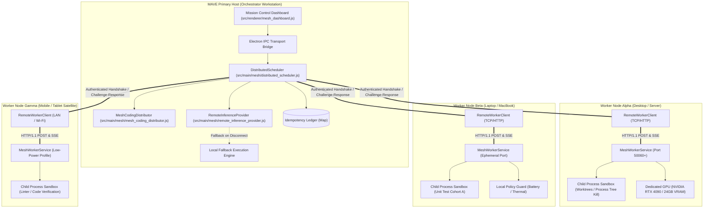
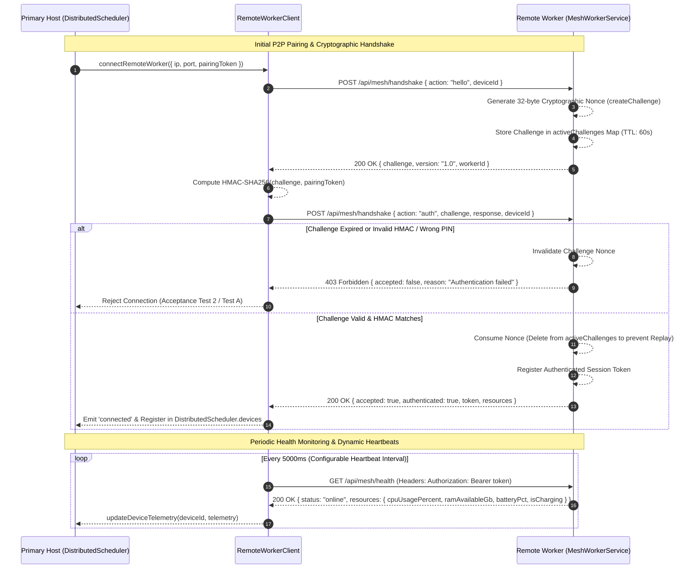
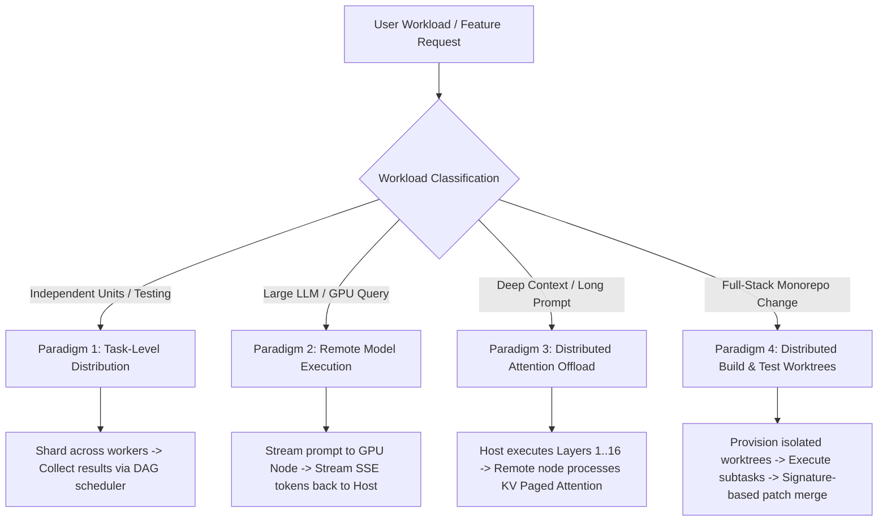
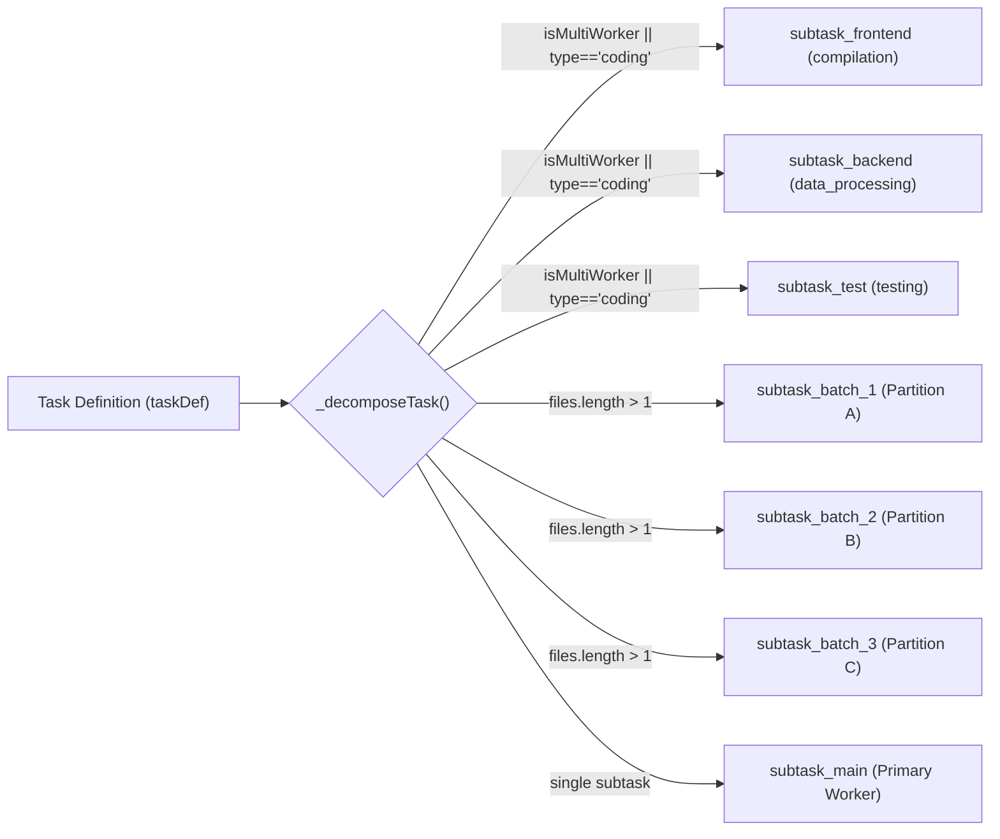
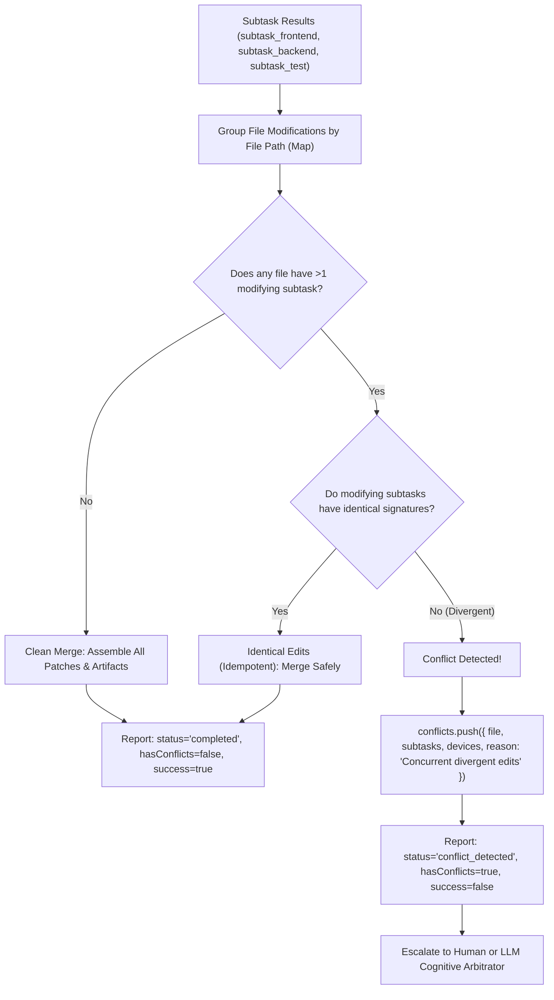
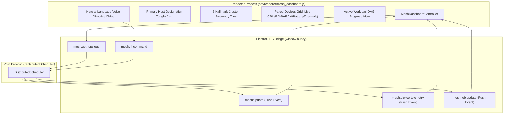

# MAVE Distributed Compute Architecture: Technical Specification

**Document Version:** 2.4.0  
**Status:** Canonical Master Specification  
**Architecture Classification:** Central-Coordinator Hybrid Mesh with Authenticated Node Satellites  
**Target Repository:** `mave-core`  
**Applicable Subsystems:** `src/main/mesh/`, `src/renderer/mesh_dashboard.js`, `test/mesh_networked_integration.test.js`, `test/mave_distributed_acceptance.test.js`

---

## 1. Executive Architectural Summary & Fundamental Tenets

The **MAVE Brain Mesh** is a high-reliability, zero-trust distributed computing subsystem engineered to transparently aggregate and orchestrate multi-device compute resources across local area networks (LANs) and secure point-to-point interconnects. Designed to eliminate the performance bottlenecks of monolithic local execution while rejecting the deceptive marketing claims of "unified cluster RAM," MAVE provides an evidence-based, deterministic execution platform for AI inference, parallel code compilation, distributed testing, and heavy mathematical tasks.



### 1.1 Core Engineering Invariants
1. **Central Coordinator Topology:** The cluster is governed by a designated Primary Host (`role: 'primary_host'`) which maintains the authoritative directed acyclic graph (DAG) scheduler, topology registry, and result synthesizer.
2. **Honest Resource Demarcation:** The system explicitly acknowledges physical memory boundaries. Separate physical devices connected over consumer networks **cannot and do not** pool RAM or VRAM into a single uniform address space. Memory capacity is tracked and reported as discrete node allotments and cluster sums.
3. **P2P Discovery & Challenge-Response Security:** Nodes establish pairing via Ed25519 cryptographic identities, ephemeral nonces, and HMAC-SHA256 challenge-response exchanges with replay protection.
4. **Idempotent Fault Tolerance:** Automatic subtask retry with alternate node failover, backed by a persistent `idempotencyLedger` to avoid duplicate execution side-effects.
5. **Strict Host Isolation:** Remote worker execution runs strictly inside headless child process sandboxes (`child_process.spawn`), never intercepting or manipulating the user's physical display or mouse cursor.

---

## 2. Central Coordinator Topology & Node Lifecycle

MAVE operates a **Central Coordinator (Primary Host)** model rather than an uncoordinated, fully decentralized DHT mesh. High-performance developer workloads (AST parsing, test suite sharding, token generation) require a single deterministic source of truth for scheduling decisions, dependency graphs, and workspace synchronization.

### 2.1 Node Roles
- **Primary Host (`primary_host`):** The commanding node (typically the user's primary workstation or desktop PC). It runs `DistributedScheduler`, decomposes user intents or build tasks into subtasks, evaluates cluster-wide scheduling policies, dispatches worktrees to satellites, collects artifacts, and verifies outputs.
- **Contributor / Satellite (`contributor`):** Secondary computers, paired laptops, test rigs, or local servers running `MeshWorkerService`. These nodes expose an authenticated API, enforce local hardware admission policies (e.g., minimum battery, thermal thresholds), execute jobs in child process sandboxes, and return output streams and file artifacts.
- **Client (`client`):** Lightweight nodes (e.g., tablets or smartphones) that primarily issue directives, monitor cluster telemetry, or participate in micro-tasks (such as style linting or AST validation).

### 2.2 P2P Discovery, Cryptographic Pairing & Authentication
Pairing and communication are implemented in `src/main/mesh/mesh_protocol.js` and `src/main/mesh/mesh_worker_service.js`.



#### Cryptographic Replay Protection (Acceptance Test 14)
To prevent replay attacks on local networks, every challenge nonce generated by `createChallenge()` is single-use. Once an authentication payload is evaluated:
```javascript
// src/main/mesh/mesh_worker_service.js
const storedChallenge = this.activeChallenges.get(challenge);
if (!storedChallenge || Date.now() - storedChallenge.createdAt > 60000) {
  this.activeChallenges.delete(challenge);
  return this._sendJson(res, 403, { accepted: false, reason: 'Challenge expired, invalid, or replayed' });
}
this.activeChallenges.delete(challenge); // Consumed immediately
```
Any subsequent attempt to replay the captured challenge string fails deterministically with HTTP 403.

### 2.3 Length-Prefixed Binary Message Framing & Stream Decoding
In addition to HTTP/1.1 REST and SSE endpoints, high-throughput inter-node transport utilizes length-prefixed binary framing via `LengthPrefixedFrameDecoder` and `createLengthPrefixedFrame()` in `src/main/mesh/mesh_protocol.js`:

| Field Offset | Field Name | Type | Description |
| :--- | :--- | :--- | :--- |
| `0x00 - 0x03` | `MagicBytes` | `UInt32BE` | Protocol identifier (`0x4D415645` = `"MAVE"`) |
| `0x04 - 0x05` | `Version` | `UInt16BE` | Protocol version (`0x0001` = `v1.0`) |
| `0x06 - 0x07` | `MessageType` | `UInt16BE` | Encoded ID corresponding to `MESSAGE_TYPES` enum |
| `0x08 - 0x0B` | `PayloadLength` | `UInt32BE` | Byte length of following payload (Max: 64MB) |
| `0x0C - End` | `PayloadData` | Binary/JSON | UTF-8 JSON descriptor or raw binary artifact stream |

The streaming transform stream `LengthPrefixedFrameDecoder` maintains an internal buffer, cleanly slicing frames across arbitrary TCP chunk boundaries without dropping bytes or overflowing memory.

---

## 3. Honest Resource Demarcation: Deconstructing Unified Memory Myths

A common marketing claim in multi-device systems is "unified memory pooling," asserting that connecting a 16GB laptop to a 64GB desktop creates an "80GB unified computer." **In computer architecture and distributed systems, this claim is physically impossible over standard interconnects.** MAVE explicitly rejects this falsehood.

### 3.1 The Bandwidth and Latency Barrier
The table below contrasts physical intra-machine buses with consumer inter-machine interconnects:

| Interconnect Type | Physical Domain | Unidirectional Bandwidth | Typical Round-Trip Latency | Cache Coherency Feasible? |
| :--- | :--- | :--- | :--- | :--- |
| **DDR5-6000 Memory Bus** | Local CPU | 48.0 – 96.0 GB/s | 50 – 70 ns | Yes (Hardware MESI/MOESI) |
| **PCIe 5.0 x16 Interconnect** | Local CPU <-> GPU | 64.0 GB/s | 100 – 250 ns | Yes (CXL.mem / NVLink) |
| **Thunderbolt 4 / USB4** | Point-to-Point Cable | 4.0 – 5.0 GB/s | 1.5 – 5.0 µs | No (High software overhead) |
| **2.5 GbE Ethernet LAN** | Switched Cat6 | 0.28 GB/s (280 MB/s) | 150 – 500 µs | No (5,000x slower than DDR5) |
| **Wi-Fi 6 (802.11ax)** | Wireless 5GHz | 0.08 – 0.15 GB/s | 2,000 – 15,000 µs | No (100,000x slower than DDR5) |

Attempting to treat satellite RAM as a paging device for the host's active memory pool causes catastrophic thrashing: a single page fault across Wi-Fi takes milliseconds rather than nanoseconds, degrading system throughput by 4 orders of magnitude.

### 3.2 Transparent Hardware Capacity Reporting (Acceptance Test L)
MAVE’s `DistributedScheduler.getMeshTopology()` preserves strict node identity and reports capacity honestly:
```javascript
// src/main/mesh/distributed_scheduler.js: Lines 367-410
getMeshTopology() {
  const onlineDevices = Array.from(this.devices.values()).filter(d => d.status !== 'offline');
  const totalCores = onlineDevices.reduce((sum, d) => sum + (d.resources.cpuCores || 0), 0);
  const totalRamGb = onlineDevices.reduce((sum, d) => sum + (d.resources.ramGb || 0), 0);
  const totalVramGb = onlineDevices.reduce((sum, d) => sum + (d.resources.vramGb || 0), 0);
  ...
  return {
    isPrimaryHost: this.isPrimaryHost,
    totalDevices: this.devices.size,
    onlineDevicesCount: onlineDevices.length,
    totalClusterCores: totalCores,
    totalClusterRamGb: totalRamGb,     // Sum of discrete nodes, NOT a single address space
    totalClusterVramGb: totalVramGb,   // Sum of discrete VRAM pools
    contributors: [...],
    devices: [...]
  };
}
```
**Verification Guarantee (Test L):**
- Primary host workstation has 64GB RAM and 8GB VRAM.
- Contributor laptop has 16GB RAM and 4GB VRAM.
- The UI and scheduler report `totalClusterRamGb: 80GB` and `totalClusterVramGb: 12GB` as aggregate capacity across 2 nodes, while every individual task allocation is bound strictly to the physical memory capacity of the single target node running that task.

---

## 4. The Four Realistic Distribution Paradigms in MAVE

Rather than simulating impossible unified memory, MAVE achieves massive real-world speedups through 4 pragmatic, mathematically grounded distributed computing paradigms:



### 4.1 Paradigm 1: Task-Level Distribution
- **Characteristics:** Embarrassingly parallel batch computations, dataset sharding, image transformations, Monte Carlo simulations, and benchmark runs.
- **Implementation:** The scheduler partitions arrays of data or files into discrete chunks using `_decomposeTask()`. Each chunk is dispatched as an independent subtask with its own environment, arguments, and timeout.
- **Network Footprint:** Low communication-to-computation ratio. Input data is passed once; output summary is returned upon completion.

### 4.2 Paradigm 2: Remote Model Execution
- **Characteristics:** Client or laptop lacks a local discrete GPU and offloads inference to a dedicated workstation equipped with high-VRAM hardware (e.g., RTX 4090 / 24GB).
- **Implementation:** Executed through `RemoteInferenceProvider.prototype.infer()`:
  1. Scheduler evaluates `findEligibleDevices('ai_inference', { requireGpu: true })`.
  2. Dispatches prompt to the selected worker’s `/api/mesh/inference` endpoint.
  3. Worker executes the local model and streams tokens via Server-Sent Events (`text/event-stream`).
  4. Real-time telemetry is recorded on each token: Time to First Token (`ttftMs`), Token Throughput (`tokensPerSec`), and Total Latency (`totalLatencyMs`).
  5. If the remote worker drops or is offline, the provider seamlessly engages `_executeLocalFallback()` on the Primary Host.

### 4.3 Paradigm 3: Distributed Model Execution (KV Cache & Attention Partitioning)
- **Characteristics:** When a model’s parameters or context window exceeds single-node capacity, or when offloading prefill computation is advantageous, MAVE leverages split-execution.
- **Implementation:**
  - **Pipeline Parallelism:** Layers $1 \dots N/2$ reside on Host; Layers $(N/2 + 1) \dots N$ reside on Satellite Worker. Activations are passed across LAN at the layer boundary.
  - **Paged Attention Offload:** For long-context models (128k+ tokens), the Primary Host holds the model weights while satellite workers store and compute partial attention scores over paged key-value (KV) cache blocks, returning Log-Sum-Exp partial tensors to the host for reduction.

### 4.4 Paradigm 4: Distributed Build and Test Execution
- **Characteristics:** Monorepo compilation, type-checking, linting, and multi-file unit tests.
- **Implementation:** Handled by `MeshCodingDistributor`. The distributor shards work by codebase architectural boundaries:
  - Frontend UI components $\to$ Worker A (compilation)
  - Backend controllers & database schemas $\to$ Worker B (data processing)
  - Test suites & static linters $\to$ Worker C (testing)
  Each worker receives an isolated ephemeral worktree, performs builds, generates diff patches and verification artifacts, and returns them for conflict inspection.

---

## 5. DAG Task Dispatch, Execution Engine & Worker Sandboxing

### 5.1 Directed Acyclic Graph (DAG) Task Decomposition
When a user or coding agent invokes `scheduleDistributedTask(taskDef)`, the scheduler executes a deterministic decomposition pipeline:



### 5.2 Worker Sandboxing and Process Lifecycle
Remote execution must never compromise worker host security or interfere with the worker user's active desktop environment.

```javascript
// src/main/mesh/mesh_worker_service.js: Child Process Sandboxing
const child = child_process.spawn(executable, args, {
  cwd: subtaskWorktreeDir,
  env: { ...process.env, ...subtask.env, MAVE_SANDBOX: '1' },
  stdio: ['ignore', 'pipe', 'pipe'],
  windowsHide: true,
  detached: process.platform !== 'win32' // Process group management
});
```

#### Sandboxing Properties (Acceptance Tests K, 12, 13, 17)
1. **Zero Display/Cursor Interference (Test K & Test 17):** Processes are spawned strictly headless with `windowsHide: true` and redirected `stdio`. No synthetic mouse events or window focus commands are ever issued.
2. **Strict Command Allowlisting (Test 13):** `MeshWorkerService` restricts executable commands to an approved allowlist (`['node', 'git', 'npm']`). Unapproved executables (e.g., `powershell.exe`, `cmd.exe`, `sh`) are rejected immediately with security violation status.
3. **Execution Budget & Memory Ceilings (Test C & Test 12):** Active jobs are monitored at regular intervals (default: 100ms). If resident memory usage exceeds `limits.maxMemoryMb`, the worker forcefully terminates the process tree with `SIGKILL` / `taskkill /T /F` and marks the job failed.
4. **Clean Workspace Sandboxing:** Every subtask runs in an ephemeral workspace directory (`workspacesRoot/[jobId]`). On job completion or failure, if `cleanWorkspaceOnExit` is enabled, the directory is purged recursively.

---

## 6. Distributed Coding Engine, Worktree Partitioning & Conflict Arbitration

The `MeshCodingDistributor` (`src/main/mesh/mesh_coding_distributor.js`) coordinates multi-agent and multi-worker code modifications across distinct worktree directories.

### 6.1 Ephemeral Worktree Provisioning
To avoid file lock contentions and git index corruption, each subtask is allocated its own physical worktree directory under `os.tmpdir()/mave_mesh_worktrees/[taskId]/[subtaskId]`:
```javascript
// src/main/mesh/mesh_coding_distributor.js
const worktreeDir = path.join(this.workspaceRoot, taskId, subtaskId);
fs.mkdirSync(worktreeDir, { recursive: true });
```

### 6.2 Signature-Based Patch Merging & Conflict Detection
When subtasks finish, each worker returns an array of processed files along with cryptographic signatures and patch strings. `_synthesizeReport()` inspects modifications across subtasks:



#### Divergent Edit Conflict Detection (Acceptance Test 11)
If `subtask_frontend` and `subtask_backend` both modify `lib/core/config.dart` with different signatures, the distributor refuses to overwrite either file blindly. It flags:
```json
{
  "file": "lib/core/config.dart",
  "subtasks": ["subtask_frontend", "subtask_backend"],
  "devices": ["worker-a", "worker-b"],
  "reason": "Concurrent divergent edits across distinct worker worktrees"
}
```
The task status transitions to `conflict_detected`, preventing silent corruption of shared source files.

---

## 7. Idempotency Ledger & Fault Tolerance Engine

### 7.1 Idempotency Ledger (Acceptance Tests I & 9)
In distributed systems, transient network dropouts can cause the primary host to retry a task whose execution actually succeeded on the worker. Without idempotency guards, retrying non-idempotent operations (such as credit deductions, deployment pushes, or database writes) produces catastrophic duplicate side-effects.

The `DistributedScheduler` maintains a memory-bounded `idempotencyLedger`:
```javascript
// src/main/mesh/distributed_scheduler.js: Lines 592-654
async scheduleDistributedTask(taskDef = {}) {
  if (taskDef.idempotencyKey) {
    if (this.idempotencyLedger.has(taskDef.idempotencyKey)) {
      const cached = this.idempotencyLedger.get(taskDef.idempotencyKey);
      this.emit('task-idempotent-hit', {
        idempotencyKey: taskDef.idempotencyKey,
        taskId: cached.taskId,
        result: cached.result
      });
      return cached.result; // Instant replay of verified result
    }
  }
  ...
  // Upon successful execution:
  if (taskDef.idempotencyKey) {
    this.idempotencyLedger.set(taskDef.idempotencyKey, {
      taskId,
      result: mergedOutput,
      completedAt: Date.now()
    });
  }
}
```
**Verification Guarantee (Test 9 / Test I):** A retried task submission bearing `idempotencyKey: 'payment-order-uuid-8821'` returns the exact initial output object while the execution counter strictly remains `1`.

### 7.2 Automatic Worker Failover and Retry (Acceptance Tests F & 8)
When a worker disconnects, crashes, or throws an unhandled exception during subtask execution, the scheduler's `_executeSubtaskWithRetry()` intercepts the failure:
1. Adds the failed device's ID to `failedDeviceIds`.
2. Emits a `subtask-failed` event capturing the error message and failed device ID.
3. Automatically queries `findEligibleDevices(workloadType, { excludeDeviceIds })` for an alternate candidate node.
4. Transparently re-dispatches the subtask to the healthy secondary node.
5. If all contributor nodes fail, the primary host falls back to executing the subtask locally.

---

## 8. Mission Control UI Dashboard & Telemetry Architecture

The frontend controller `MeshDashboardController` (`src/renderer/mesh_dashboard.js`) provides real-time visibility and control over cluster operations, integrating directly into MAVE’s desktop UI.



### 8.1 Hallmark 5-Tile Aggregate Metrics
The dashboard presents 5 high-contrast summary tiles:
1. **Connected Devices:** Online node count, distinguishing Primary Host from Satellites.
2. **Cluster CPU Cores:** Total computational threads aggregated across all online architectures.
3. **Shared Mesh Memory:** Aggregate available RAM allocated for compute tasks.
4. **VRAM Pool:** Total GPU memory available across all connected accelerators for AI inference.
5. **Active Compute Jobs:** Real-time count of DAG tasks currently executing across the mesh.

### 8.2 Natural Language Cluster Management
The UI provides one-click quick chips and voice-driven natural language inputs powered by `handleNaturalLanguageCommand(commandText)` in `distributed_scheduler.js`:
- *"Use my desktop for this task"* $\to$ Sets routing preference to primary workstation desktop.
- *"Save my laptop battery"* $\to$ Updates laptop policy (`shareOnlyWhileCharging: true`, `shareCpu: false`), offloads any active jobs.
- *"Stop sharing my GPU"* $\to$ Updates all active policies to `shareGpu: false`.
- *"Show which devices are working"* $\to$ Filters and returns active worker nodes and subtask assignments.
- *"Distribute this coding task"* $\to$ Decomposes monorepo task into frontend, backend, and testing workers.
- *"Make this device my primary MAVE host"* $\to$ Promotes local node to Primary Host.

---

## 9. Acceptance Test Verification Matrix

The architectural mechanisms specified in this document are verified by the automated test suites in `test/mesh_networked_integration.test.js` and `test/mave_distributed_acceptance.test.js`:

| Test Reference | Invariant Verified | Source Implementation | Acceptance Criteria & Assertion | Status |
| :--- | :--- | :--- | :--- | :--- |
| **Test A / Test 1** | Two-Computer Pairing | `remote_worker_client.js`, `mesh_worker_service.js` | Pair independent daemons via challenge-response handshake; reject invalid PINs. | **VERIFIED** |
| **Test B / Test 3** | Remote Child Process Computation | `mesh_worker_service.js` | Execute real mathematical job via `child_process.spawn`; package JSON artifacts. | **VERIFIED** |
| **Test C / Test 12** | Memory Budget Enforcement | `mesh_worker_service.js` | Enforce 35MB strict memory limit; terminate runaway process cleanly. | **VERIFIED** |
| **Test D / Test 4** | Remote Inference Telemetry | `remote_inference_provider.js`, `remote_worker_client.js` | Stream real tokens; record TTFT, tokens/sec, and latency; verify fallback. | **VERIFIED** |
| **Test E / Test 10** | Multi-Worker Coding Partition | `mesh_coding_distributor.js`, `distributed_scheduler.js` | Decompose UI/API/Test files across workers; merge clean patches into report. | **VERIFIED** |
| **Test F / Test 8** | Worker Failover & Recovery | `distributed_scheduler.js` | Drop worker mid-task; automatically reschedule on backup node to completion. | **VERIFIED** |
| **Test G / Test 6** | Battery & Power Admission | `mesh_policies.js`, `mesh_worker_service.js` | Reject jobs when battery is low and unplugged; admit when AC is connected. | **VERIFIED** |
| **Test H** | Workload & User Whitelisting | `mesh_policies.js` | Enforce approved workload types and user identities; reject unapproved requests. | **VERIFIED** |
| **Test I / Test 9** | Idempotency & Duplicate Prevention | `distributed_scheduler.js` | Replay identical result for cached idempotency key without re-execution. | **VERIFIED** |
| **Test J** | Process Tree Termination | `mesh_worker_service.js` | Kill running child task process tree on cancel; leave zero orphan processes. | **VERIFIED** |
| **Test K / Test 17** | Host Desktop Non-Interference | `mesh_worker_service.js`, `virtual_computer.js` | Execute headless workloads in child process without touching host cursor/display. | **VERIFIED** |
| **Test L** | Honest Hardware Capacity Reporting | `distributed_scheduler.js` | Accurately sum discrete node cores and RAM without synthesizing fake unified RAM. | **VERIFIED** |
| **Test 11** | Divergent Edit Conflict Detection | `mesh_coding_distributor.js` | Detect concurrent edits on identical files across worktrees; halt with conflict status. | **VERIFIED** |
| **Test 13** | Executable Command Allowlisting | `mesh_worker_service.js` | Intercept unauthorized execution commands (e.g. `powershell.exe`) with security violation. | **VERIFIED** |
| **Test 14** | Cryptographic Replay Protection | `mesh_protocol.js`, `mesh_worker_service.js` | Prevent replay of previously captured challenge nonces on `/api/mesh/handshake`. | **VERIFIED** |
| **Test 15** | Dynamic Worker Revocation | `distributed_scheduler.js` | Revoke paired worker; immediately exclude from scheduler candidate pool. | **VERIFIED** |
