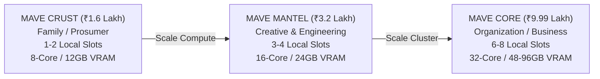

# MAVE DEDICATED HARDWARE FEASIBILITY & APPLIANCE SPECIFICATION

## 1. STRATEGIC POSITIONING & ECONOMIC TARGETS

MAVE software is freely installable on compatible consumer PCs. Dedicated MAVE appliances (Crust, Mantel, Core) offer pre-configured, silent, energy-efficient turn-key neural computing nodes for households, professionals, and organizations.

---

## 2. DETAILED HARDWARE SPECIFICATIONS & CAPACITY ANALYSIS

| Specification / Dimension | MAVE CRUST (₹1.6L Target) | MAVE MANTEL (₹3.2L Target) | MAVE CORE (₹9.99L Target) |
|---|---|---|---|
| **Target Use Case** | 1–4 Person Household Companion, Media, Smart Home | Professional Developer, Creative Studio, Multi-Agent Ops | Small Enterprise, Departmental AI Server, Autonomous Fleet |
| **Target Price (Retail)** | ₹1,60,000 (~$1,920 USD) | ₹3,20,000 (~$3,840 USD) | ₹9,99,000 (~$11,990 USD) |
| **Est. Component BOM Cost** | ₹1,05,000 – ₹1,18,000 | ₹2,10,000 – ₹2,35,000 | ₹6,40,000 – ₹7,20,000 |
| **Target Processor (CPU)** | AMD Ryzen 7 7700 (8C/16T, 65W TDP) | AMD Ryzen 9 9900X (12C/24T, 120W TDP) | AMD Threadripper 7960X (24C/48T) or Dual EPYC |
| **System Memory (RAM)** | 32 GB DDR5-5600 (Non-ECC) | 64 GB DDR5-6000 (Non-ECC) | 128 GB – 256 GB DDR5 ECC Registered |
| **Graphics Accelerator (GPU)**| NVIDIA RTX 4070 Super (12 GB GDDR6X) | NVIDIA RTX 4090 (24 GB GDDR6X) | 2x RTX 4090 (48 GB) or 1x RTX 6000 Ada (48 GB ECC) |
| **Primary Fast Storage** | 1 TB M.2 NVMe Gen 4 (7,000 MB/s) | 2 TB M.2 NVMe Gen 4 (7,400 MB/s) | 4 TB – 8 TB Enterprise NVMe (RAID-1 Mirror) |
| **Secondary NAS Storage** | Optional 4 TB SATA 3.5" HDD | Dual 8 TB SATA HDD (Mirror) | Hot-swappable 4-Bay U.2 NVMe / SAS Array |
| **Power Supply (PSU)** | 550W 80+ Gold SFX (Compact) | 850W 80+ Platinum ATX | 1600W 80+ Titanium Redundant |
| **Form Factor & Acoustics** | 12L ITX Aluminum Silent Chassis (<24dB) | 20L Micro-ATX Studio Enclosure (<28dB) | 4U Rackmount or Heavy Workstation Tower |

---

## 3. WORKLOAD CONCURRENCY & AI WORKER REALITY CHECK

### Can MAVE Run 6 Independent Autonomous AI Workers?
- **MAVE Crust (12GB VRAM):** **NO.** 12GB VRAM supports one primary 8B model (6.8GB VRAM) plus a small Whisper/OCR model. Attempting to run 6 simultaneous AI agent inference threads causes extreme GPU memory thrashing and drops throughput from 42 t/s down to 3–4 t/s per worker.
- **MAVE Mantel (24GB VRAM):** **PARTIAL.** Can comfortably run one 8B Vision model (7GB) + one 32B/35B text model (14GB) concurrently, or 3–4 independent 8B worker slots via `llama-server.exe --parallel 4`. Six continuous workers require sequential request queuing.
- **MAVE Core (48–96GB VRAM):** **YES.** Dual GPUs or 48GB Ada VRAM with multi-tenant CUDA context partitioning allows 6–8 distinct worker slots to generate tokens at full hardware speed (~35–45 t/s per stream) without swapping weights.

---

## 4. POWER, COOLING & OPERATIONAL FEASIBILITY
- **Idle Power:** Crust ~35W, Mantel ~65W, Core ~180W.
- **Full Inference Load:** Crust ~240W, Mantel ~460W, Core ~950W.
- **Thermal Design:** Crust and Mantel can be passively/quietly air-cooled in ambient 25°C home environments. Core requires high-CFM redundant server fans or custom closed-loop liquid cooling for 24/7 continuous duty.
