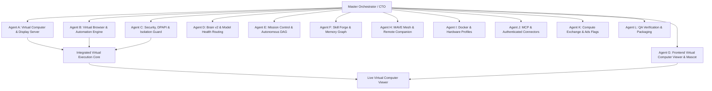

# MAVE MASTER BUILD PLAN: VIRTUAL COMPUTER & AUTONOMOUS AGENT ECOSYSTEM

**Architecture Version:** 2.5.0-LTS  
**Target Milestone:** Phase 1.2 / Phase 2 Core Software Release  
**Execution Standard:** Zero Dummy Data · Real Virtualization & Isolation · Non-Interference Invariant  

---

## 1. EXECUTIVE DIRECTIVE & ARCHITECTURAL FOUNDATION

The core product philosophy of MAVE is:
> **"The user's computer belongs to the user. MAVE works inside MAVE's own Virtual Computer."**

When a user asks MAVE to browse, research, code, scrape, create documents, or run multi-step automations, MAVE executes exclusively inside its **isolated Virtual Computer and Virtual Browser**, leaving the user's physical mouse, keyboard focus, browser tabs, and desktop completely unhindered.

### The 4 Execution Environments
1. **Environment 1 — MAVE Virtual Browser:** Isolated offscreen browser workspace (Chromium/Playwright-backed with independent display buffer, tabs, DOM selectors, virtual mouse/keyboard). Default for all web research and web apps.
2. **Environment 2 — MAVE Virtual Computer:** Guest operating environment with virtual display server, guest filesystem sandbox, virtual terminal shell, and guest execution daemon. Default for coding, scripts, data analysis, and document builds.
3. **Environment 3 — MAVE Isolated Worker Containers:** Non-GUI containerized sandboxes for batch processing, tool services, and data transformation.
4. **Environment 4 — User Host Computer:** Windows native `SendInput` and UI Automation. **Used ONLY when the user explicitly requests host control and grants interactive authorization.** Never a silent fallback!

---

## 2. ENGINEERING WORKSTREAM DECOMPOSITION

To execute this program with maximum velocity, the project is divided into 12 specialized engineering workstreams:

---

## 3. IMPLEMENTATION SCHEDULE & DEPENDENCY GRAPH

| Step | Workstream / Module | Core Deliverables | Dependencies |
|---|---|---|---|
| **Phase A** | **Virtual Computer Core** (`src/main/virtual_computer/`) | `VirtualMachineManager`, `VirtualDisplayServer`, `VirtualDesktopController`, `VirtualFileBridge` | None |
| **Phase B** | **Virtual Browser Engine** | `VirtualBrowserController`, multi-tab manager, virtual cursor renderer, offscreen paint streamer | Phase A |
| **Phase C** | **Execution Target Router & Agent Hook** | `ExecutionTargetRouter`, update `agent.js` & `computer.js` to route all tasks to Virtual Computer by default | Phase A, B |
| **Phase D** | **Frontend Virtual Computer Viewer** | `src/renderer/virtual_computer.html`, canvas display streamer, manual takeover mode, IPC bridge | Phase B, C |
| **Phase E** | **Autonomous Mission Control & Skill Forge** | `MissionController`, `SkillForge`, `WorkerManager`, reproducible workflow learning | Phase C |
| **Phase F** | **Multi-Tenant Memory & Security Hardening** | Per-user SQLite memory isolation, complete DPAPI secrets encryption, permission broker | None |
| **Phase G** | **Non-Interference Verification Suite** | Automated test suite proving 0 displacement of host mouse cursor and active window during full tasks | Phase A-D |
| **Phase H** | **Release Packaging & Build Verification** | Electron builder packaging verification, test suite execution, architecture status reports | All |

---

## 4. INVARIANTS & DEFINITION OF DONE
- **Host Non-Interference:** `GetCursorPos` and `GetForegroundWindow` on the Windows host must remain unchanged during guest browser and computer tasks.
- **Production Authenticity:** Zero mock responses or fake completion messages. Real display buffers, real virtual terminals, real filesystem operations.
- **Test Gate:** Every new subsystem must have a dedicated automated test suite in `test/` passing with 0 errors.
