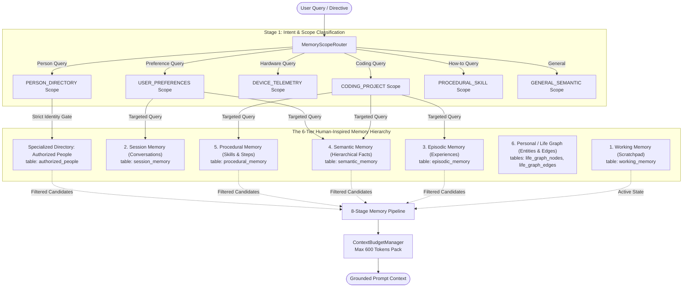
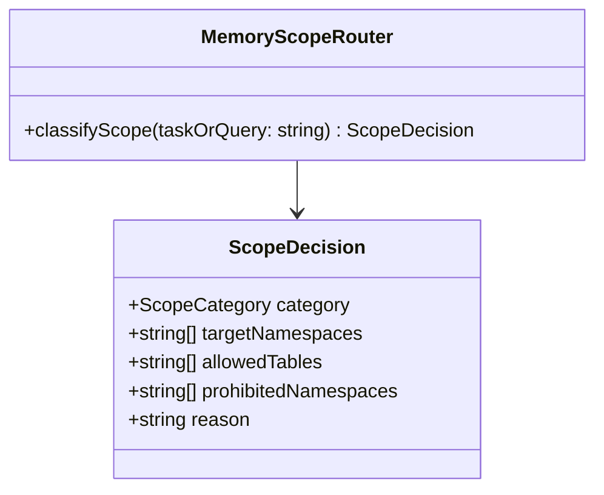
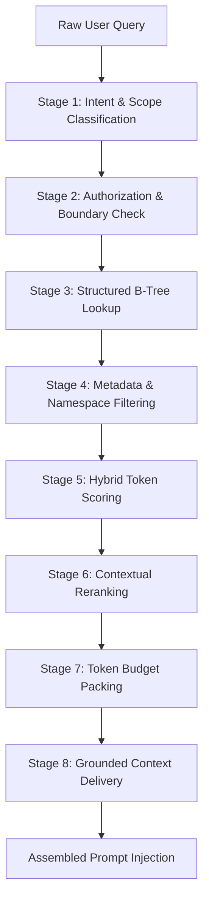

# MAVE Memory Architecture V2: Human-Inspired Multi-Tier Memory Engine

**Author:** Principal Memory Systems Architect  
**Subsystem:** MAVE Cognitive Memory Engine (`src/main/memory`)  
**Status:** Canonical Engineering Specification  
**Invariants Enforced:** Gravitas Grounding, Scope Isolation, Multi-Tenant Privacy, Zero Context Dilution  

---

## 1. Executive Summary & The Context Dilution Problem

Traditional AI assistants implement long-term memory using naive "flat injection": reading an entire flat JSON file (e.g., `memory.json`) or scanning all vector embeddings on every conversational turn, dumping the retrieved facts into the system prompt.

In production desktop assistants, flat injection causes severe systemic degradation:
1. **Context Window Pollution & Cost:** Dumping hundreds of facts exhausts LLM context windows (consuming 3,000–8,000 tokens per turn before user content is even evaluated).
2. **Attention Dilution & Hallucination:** When an LLM is presented with irrelevant memories (e.g., family relationships or grocery preferences during a C++ debugging session), it frequently references or cross-contaminates variables with unrelated facts.
3. **Privacy & Security Leakage:** Unscoped memory dumps cross multi-tenant boundaries and expose sensitive biometrics or private notes to general queries.
4. **Latency Degradation:** Unindexed linear scans scale as $O(N)$ with conversation history, adding hundreds of milliseconds of compute time per turn.

**MAVE V2 solves this by implementing a 6-level human-inspired memory architecture governed by an active `MemoryScopeRouter` and an 8-stage retrieval pipeline powered by SQLite `DatabaseSync`.**



---

## 2. The 6-Level Human-Inspired Memory Hierarchy

MAVE organizes cognition into 6 distinct tiers modeled on human neurocognitive memory systems, plus an isolated identity directory. Each tier possesses its own persistence lifecycle, indexing strategy, and retrieval scope.

| Level | Memory Tier | Biological Analog | Storage Abstraction | Retention Policy | Typical Scope |
| :--- | :--- | :--- | :--- | :--- | :--- |
| **Level 1** | **Working Memory** | Prefrontal Cortex (Working Memory) | SQLite `working_memory` | Transient (Task duration) | Active objective, current subtask, tool scratchpad, constraints |
| **Level 2** | **Session Memory** | Short-Term Episodic Buffer | SQLite `session_memory` | Conversation session (Days) | Decisions made, turn count, unresolved questions, user corrections |
| **Level 3** | **Episodic Memory** | Hippocampus (Autobiographical) | SQLite `episodic_memory` | Permanent / Decayed | Specific past tasks, tools used, physical outcomes, verification status |
| **Level 4** | **Semantic Memory** | Temporal Lobe (Neocortex) | SQLite `semantic_memory` | Permanent (Updated on contradiction) | Distilled facts, tech stacks, user preferences, entity properties |
| **Level 5** | **Procedural Memory** | Striatum / Basal Ganglia | SQLite `procedural_memory` | Permanent (Success weighted) | Reusable skills, how-to workflows, CLI scripts, test steps |
| **Level 6** | **Personal / Life Graph** | Associative Cortex | SQLite `life_graph_nodes` & `edges` | Permanent | Relationships (Person -> Project, User -> Goal, Device -> Spec) |
| **Special** | **Authorized People** | Facial Fusiform Area (Identity) | SQLite `authorized_people` | Permanent (Explicit consent) | Biometrics, relationships, authorized command scopes |

---

### Tier 1: Working Memory (Active Task Scratchpad)
- **Role:** Holds the immediate state of the active mission. It prevents the agent from forgetting its current subtask mid-execution.
- **Backing Table:** `working_memory` (indexed by `task_id`).
- **Fields:** `active_objective`, `current_subtask`, `constraints_json`, `active_tool_results_json`, `token_budget`, `updated_at`.
- **Concurrency:** Single row per active task; updated on every subtask transition via `ON CONFLICT(task_id) DO UPDATE`.

### Tier 2: Session Memory (Conversations & Decisions)
- **Role:** Preserves continuity across a conversational thread without storing verbatim tokens forever.
- **Backing Table:** `session_memory` (indexed by `session_id`).
- **Fields:** `project_id`, `summary`, `decisions_json`, `corrections_json`, `turn_count`, `created_at`, `updated_at`.
- **Lifecycle:** Summarized periodically by background workers; holds architectural decisions and user corrections made during that session.

### Tier 3: Episodic Memory (Experiences & Outcomes)
- **Role:** Records historical experiences—what MAVE attempted, what tools it ran, and whether the outcome succeeded or failed.
- **Backing Table:** `episodic_memory` (indexed by `user_id, timestamp`).
- **Fields:** `event_id`, `timestamp`, `project_id`, `session_id`, `event_type`, `goal`, `entities_json`, `actions_json`, `outcome`, `verification_status`, `confidence`, `retention_policy`.
- **Utility:** Enables MAVE to learn from past mistakes. If a previous build failed due to a missing dependency, subsequent episodes reference this failure and avoid repeating it.

### Tier 4: Semantic Memory (Hierarchical Facts & Knowledge)
- **Role:** Stores timeless, verified propositional facts.
- **Backing Table:** `semantic_memory` (indexed by `user_id, namespace` and `user_id, entity_name`).
- **Fields:** `id`, `namespace`, `entity_name`, `fact`, `confidence`, `source_provenance`, `created_at`, `updated_at`, `expires_at`.
- **Namespaces:** Partitioned into `coding`, `preferences`, `device_telemetry`, `general`, `workflows`.

### Tier 5: Procedural Memory (How-To Knowledge & Skills)
- **Role:** Contains parameterized executable workflows and skill recipes.
- **Backing Table:** `procedural_memory` (indexed by `user_id, name`).
- **Fields:** `skill_id`, `name`, `description`, `preconditions_json`, `tools_needed_json`, `steps_json`, `verification_conditions_json`, `success_count`, `failure_count`, `last_tested_at`.
- **Learning Loop:** Every successful execution increments `success_count`; failures increment `failure_count`.

### Tier 6: Personal / Life Graph (Deep Associative Entities)
- **Role:** Captures multi-hop associative relationships between people, projects, repositories, hardware, and preferences.
- **Backing Tables:** `life_graph_nodes` and `life_graph_edges`.
- **Traversals:** Supports multi-hop graph queries (e.g., *"Find all repositories worked on by John that relate to Vulkan shaders"*).

### Specialized Directory: Authorized People (Consent & Biometrics)
- **Role:** Strict identity directory for enrolled individuals.
- **Backing Table:** `authorized_people` (indexed by `user_id, name`).
- **Security Rule:** Under no circumstances will MAVE identify or index unknown faces or third parties. Face recognition and personal query answering are strictly gated by this table.

---

## 3. Targeted Scope Filtering vs. Flat JSON Injection

### 3.1 The Failure of Legacy Flat JSON (`memory.json`)
Prior architectures stored all user facts in a single file `%APPDATA%/mave/memory.json`. On every turn:
1. The JSON file was parsed into memory.
2. The entire array was either injected into the prompt verbatim or subjected to simple keyword regex matching.
3. Any mention of a common word (e.g., "code", "run", "window") loaded dozens of conflicting memories across coding, domestic life, hardware specs, and personal relationships.

### 3.2 Comparison Matrix

| Dimension | Legacy Flat JSON Injection | MAVE V2 Targeted Scope Filtering |
| :--- | :--- | :--- |
| **Storage Engine** | Unindexed `memory.json` | High-throughput SQLite via `DatabaseSync` |
| **Query Complexity** | $O(N)$ linear JSON parsing | $O(\log N)$ B-tree index lookups |
| **Token Overhead** | 2,500 – 6,000 tokens per turn | **Capped at 600 tokens** via `ContextBudgetManager` |
| **Context Relevance** | Low (cross-domain noise injected) | High (strictly scoped to query domain) |
| **Contradiction Safety**| Blind append; duplicate conflicting facts | Explicit upsert via `entity_name` & `namespace` |
| **Multi-Tenant Safety** | Weak directory isolation | Cryptographic per-tenant database paths |
| **Privacy Gating** | Biometrics co-mingled with text facts | Biometrics isolated in `authorized_people` table |

---

## 4. MemoryScopeRouter: Intelligent Query Partitioning

`MemoryScopeRouter` (`src/main/memory/memory_scope_router.js`) inspects the incoming user query or task directive and classifies it into a dedicated `ScopeCategory`:

```javascript
const ScopeCategory = {
  CODING_PROJECT: 'CODING_PROJECT',
  USER_PREFERENCES: 'USER_PREFERENCES',
  DEVICE_TELEMETRY: 'DEVICE_TELEMETRY',
  PERSON_DIRECTORY: 'PERSON_DIRECTORY',
  GENERAL_SEMANTIC: 'GENERAL_SEMANTIC',
  PROCEDURAL_SKILL: 'PROCEDURAL_SKILL',
};
```

### 4.1 Scope Routing Rules & Boundary Enforcement



#### 1. `CODING_PROJECT` Scope
- **Trigger Patterns:** `code`, `function`, `bug`, `debug`, `website`, `script`, `compile`, `git`, `repo`, `api`, `server`.
- **Target Namespaces:** `['coding', 'project_knowledge', 'debug_episodes']`.
- **Allowed Tables:** `['semantic_memory', 'procedural_memory', 'episodic_memory']`.
- **Prohibited Namespaces:** `['personal_life', 'camera_observations', 'household', 'family']`.
- **Guarantee:** Never inject personal domestic details into coding prompts.

#### 2. `USER_PREFERENCES` Scope
- **Trigger Patterns:** `shorter`, `longer`, `concise`, `preference`, `prefer`, `theme`, `favorite`, `tone`, `call me`.
- **Target Namespaces:** `['preferences', 'communication_style', 'profile']`.
- **Allowed Tables:** `['semantic_memory', 'session_memory']`.
- **Prohibited Namespaces:** `['camera_observations', 'coding', 'device_telemetry']`.

#### 3. `PERSON_DIRECTORY` Scope (Strict Biometric Gate)
- **Trigger Patterns:** `who is`, `recognize`, `person`, `face`, `friend`, `family member`.
- **Target Namespaces:** `['authorized_people']`.
- **Allowed Tables:** Strictly `['authorized_people']`.
- **Prohibited Namespaces:** `['*']` (blocks all other tables).
- **Security Rule:** If an un-enrolled person is queried, the router injects a hard identity notice:
  > *"[Identity Security Notice: No enrolled, consenting person matching '<name>' was found in your authorized directory. Unverified stranger identification is blocked.]"*

---

## 5. The 8-Stage Memory Retrieval Pipeline

Retrieval in `MemoryPipeline.retrieveContext()` executes through 8 discrete stages:



### Stage 1: Intent & Scope Classification
The raw prompt is evaluated by `MemoryScopeRouter.classifyScope()`, producing allowed tables, target namespaces, and prohibited namespaces.

### Stage 2: Authorization & Boundary Check
Verifies that the executing process has rights to the active `userId`. Multi-tenant database connections are resolved via `MemoryDatabase.forUser(effectiveUserId)`.

### Stage 3: Structured B-Tree Lookup
Indexed SQL queries are dispatched against allowed tables using prepared statements:
```sql
SELECT * FROM semantic_memory 
WHERE user_id = ? AND namespace = ? 
ORDER BY updated_at DESC LIMIT 5;
```

### Stage 4: Metadata & Namespace Filtering
Enforces prohibition filters. Any candidate memory originating from a prohibited namespace is pruned before scoring.

### Stage 5: Hybrid Token Scoring
Candidate memories are scored based on base relevance, source provenance, confidence ratings, and token overlap with the active query tokens:
```javascript
const queryTokens = new Set(query.toLowerCase().replace(/[^a-z0-9\s]/g, ' ').split(/\s+/).filter(w => w.length > 2));
for (const mem of candidateMemories) {
  const memTokens = mem.text.toLowerCase().split(/\s+/);
  for (const t of memTokens) {
    if (queryTokens.has(t)) mem.score += 2;
  }
}
```

### Stage 6: Contextual Reranking
Memories are sorted in descending order of score:
```javascript
candidateMemories.sort((a, b) => b.score - a.score);
```

### Stage 7: Token Budget Packing
`ContextBudgetManager` enforces a hard token ceiling (default: 600 tokens). Candidate memories are formatted as bullet points and packed greedily until the token budget is exhausted:
```javascript
for (const mem of candidateMemories) {
  const line = `- ${mem.text}`;
  const lineTokens = this.budgetManager.estimateTokens(line);
  if (usedTokens + lineTokens <= maxMemoryTokens) {
    packedLines.push(line);
    usedTokens += lineTokens;
    usedSources.push(mem.source);
  } else {
    break;
  }
}
```

### Stage 8: Grounded Context Delivery
The packed lines are combined into `contextText` and delivered to the orchestrator along with provenance metadata (`sources`, `tokenCount`, `scopeCategory`).

---

## 6. Automatic Memory Formation & Contradiction Handling

### 6.1 Automatic Memory Formation (`processTurnForLearning`)
MAVE does not record every conversational turn into permanent semantic memory. Recording casual greetings ("Good morning", "Tell me a joke") pollutes the knowledge base.

`MemoryPipeline.processTurnForLearning()` applies heuristic feature extractors to detect enduring knowledge:
1. **Explicit Preference Expressions:** Matches phrases like *"I prefer..."*, *"Remember that I..."*, *"My preference is..."*. Stored in namespace `preferences` with confidence `1.0`.
2. **Project & Technology Stack Declarations:** Matches phrases like *"We are using Next.js with Tailwind"*, *"Our backend is Go"*. Stored in namespace `coding` under entity `project_stack`.
3. **Task Outcome Episodes:** Successfully verified deliverables automatically trigger `recordEpisode()` in episodic memory.

### 6.2 Contradiction Handling & Superseding
When a user updates a previously stated fact (e.g., *"Actually, I switched from dark mode to light mode"* or *"We migrated the database from Postgres to SQLite"*):
1. **Entity Name Matching:** `storeFact()` checks if a fact already exists for `(user_id, namespace, entity_name)`.
2. **Deterministic Upsert:** If an existing record is found, MAVE executes an `UPDATE` rather than creating a duplicate:
   ```sql
   UPDATE semantic_memory 
   SET fact = ?, confidence = ?, source_provenance = ?, updated_at = ?
   WHERE id = ?;
   ```
3. **Timestamp Provenance:** The `updated_at` timestamp is updated to the current millisecond. If multiple conflicting facts ever emerge during multi-device synchronization, the record with the higher `updated_at` and higher `confidence` supersedes the older one.

---

## 7. Multi-Tenant Isolation & Storage Layout

### 7.1 Filesystem Directory Architecture
Each user on the system has their own physically isolated SQLite database. Under no circumstances are records from different users placed in the same database file:

```text
%APPDATA%/mave/memory_v2/
  └── users/
      ├── default/
      │   └── mave_memory.db          (Default local desktop user)
      ├── usr_alice_982a/
      │   └── mave_memory.db          (Remote companion user Alice)
      └── usr_bob_771f/
          └── mave_memory.db          (Remote companion user Bob)
```

### 7.2 Security Guarantees
- **Path Sanitization:** User IDs are sanitized via `safeUid = userId.replace(/[/\\:*?"<>|]/g, '_')` to prevent path traversal exploits (`../../`).
- **Pragma Enforcement:** SQLite connections enforce `PRAGMA foreign_keys = ON`.
- **Purge Integrity:** `purgeAllData()` deletes only records matching `WHERE user_id = ?`, and `purgeUserData()` removes the isolated directory completely.

---

## 8. Summary of Architectural Guarantees

1. **Zero Flat Scans:** All memory queries are indexed by `(user_id, namespace)` or `(user_id, timestamp)`.
2. **Strict Scope Isolation:** Coding tasks never see domestic or camera observations; person searches never leak into code generation.
3. **Hard Context Budget:** Retrieval is capped at 600 tokens, eliminating context bloat.
4. **Physical Deliverable Grounding:** Episodic memory records only physically verified outcomes.
