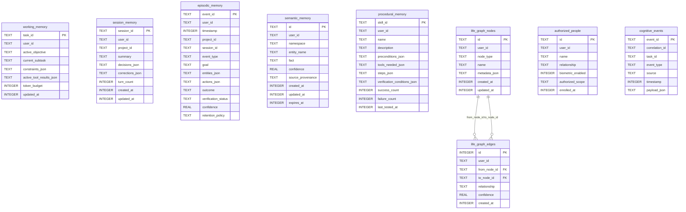
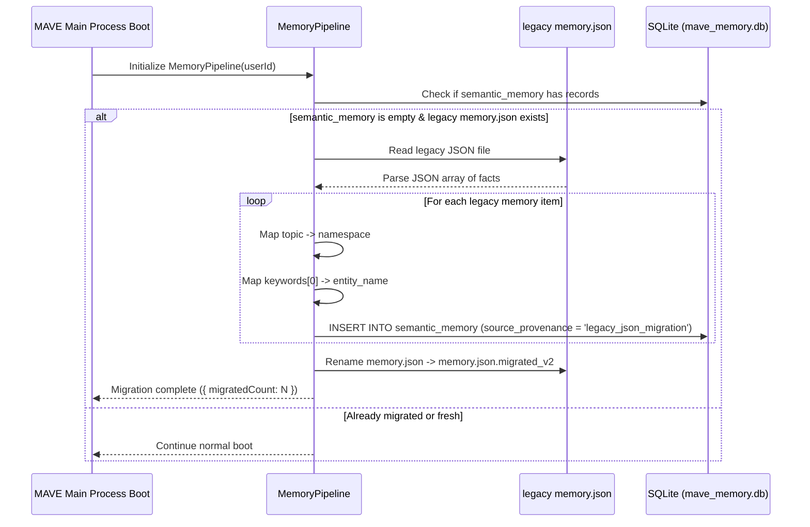

# MAVE Memory Schema Specification: SQLite DatabaseSync Storage Engine

**Author:** Principal Memory Systems Architect  
**Subsystem:** MAVE Cognitive Memory Engine (`src/main/memory/memory_database.js`)  
**Engine:** Node.js Native SQLite (`node:sqlite` `DatabaseSync`)  
**Status:** Canonical Engineering Specification  
**Invariants Enforced:** Gravitas Grounding, Strict Typing, Referential Integrity, Idempotent Migration  

---

## 1. Architecture Overview & Engine Selection

MAVE V2 transitions from flat, unindexed JSON files (`memory.json`, `knowledge_graph.json`) to a local-first, transactional SQLite storage architecture powered by Node.js native `DatabaseSync` (`node:sqlite`).

### Why `node:sqlite` `DatabaseSync`?
1. **Zero External Dependencies:** Built directly into the Node.js runtime (v22+), eliminating fragile native compilation dependencies (`better-sqlite3`, `sqlite3` node-gyp builds).
2. **Synchronous Predictability:** Eliminates async event-loop interleaving races during critical prompt assembly and tool dispatch.
3. **High Throughput In-Memory & File-Backed Support:** Seamlessly supports file-backed persistent databases (`%APPDATA%/mave/memory_v2/users/{userId}/mave_memory.db`) and lightning-fast `:memory:` test harnesses.
4. **Strict Concurrency Control:** Native WAL (Write-Ahead Logging) and robust transactional guarantees (`BEGIN IMMEDIATE`, `COMMIT`, `ROLLBACK`).



---

## 2. Complete SQLite DDL Schema Specification

The complete schema is initialized via `MemoryDatabase.initSchema()` in `src/main/memory/memory_database.js`.

```sql
-- Enforce referential integrity
PRAGMA foreign_keys = ON;

-- -------------------------------------------------------------
-- 1. Working Memory (Active Task Scratchpad)
-- -------------------------------------------------------------
CREATE TABLE IF NOT EXISTS working_memory (
  task_id                  TEXT PRIMARY KEY,
  user_id                  TEXT NOT NULL,
  active_objective         TEXT NOT NULL,
  current_subtask          TEXT,
  constraints_json         TEXT,               -- Stored as JSON object
  active_tool_results_json TEXT,               -- Stored as JSON array
  token_budget             INTEGER DEFAULT 2048,
  updated_at               INTEGER NOT NULL
);
CREATE INDEX IF NOT EXISTS idx_working_user ON working_memory(user_id);

-- -------------------------------------------------------------
-- 2. Session Memory (Conversations, Decisions & Context)
-- -------------------------------------------------------------
CREATE TABLE IF NOT EXISTS session_memory (
  session_id               TEXT PRIMARY KEY,
  user_id                  TEXT NOT NULL,
  project_id               TEXT,
  summary                  TEXT,
  decisions_json           TEXT,               -- Stored as JSON array
  corrections_json         TEXT,               -- Stored as JSON array
  turn_count               INTEGER DEFAULT 0,
  created_at               INTEGER NOT NULL,
  updated_at               INTEGER NOT NULL
);
CREATE INDEX IF NOT EXISTS idx_session_user ON session_memory(user_id);
CREATE INDEX IF NOT EXISTS idx_session_project ON session_memory(user_id, project_id);

-- -------------------------------------------------------------
-- 3. Episodic Memory (Experiences, Actions & Outcomes)
-- -------------------------------------------------------------
CREATE TABLE IF NOT EXISTS episodic_memory (
  event_id                 TEXT PRIMARY KEY,
  user_id                  TEXT NOT NULL,
  timestamp                INTEGER NOT NULL,
  project_id               TEXT,
  session_id               TEXT,
  event_type               TEXT NOT NULL,      -- e.g. 'task_execution', 'debugging', 'browser_automation'
  goal                     TEXT NOT NULL,
  entities_json            TEXT,               -- Stored as JSON array of entities involved
  actions_json             TEXT,               -- Stored as JSON array of tool actions executed
  outcome                  TEXT NOT NULL,
  verification_status      TEXT DEFAULT 'VERIFIED', -- 'VERIFIED' | 'FAILED' | 'PARTIALLY_VERIFIED'
  confidence               REAL DEFAULT 1.0,
  retention_policy         TEXT DEFAULT 'permanent'  -- 'permanent' | 'decay_30d' | 'session_only'
);
CREATE INDEX IF NOT EXISTS idx_episodic_user_time ON episodic_memory(user_id, timestamp);
CREATE INDEX IF NOT EXISTS idx_episodic_user_proj ON episodic_memory(user_id, project_id);

-- -------------------------------------------------------------
-- 4. Semantic Memory (Hierarchical Facts & Knowledge)
-- -------------------------------------------------------------
CREATE TABLE IF NOT EXISTS semantic_memory (
  id                       TEXT PRIMARY KEY,
  user_id                  TEXT NOT NULL,
  namespace                TEXT NOT NULL,      -- e.g. 'coding', 'preferences', 'device_telemetry', 'general'
  entity_name              TEXT,               -- Specific entity or null (e.g. 'project_stack', 'theme')
  fact                     TEXT NOT NULL,      -- Propositional fact string
  confidence               REAL DEFAULT 1.0,
  source_provenance        TEXT,               -- e.g. 'explicit_user_statement', 'legacy_json_migration'
  created_at               INTEGER NOT NULL,
  updated_at               INTEGER NOT NULL,
  expires_at               INTEGER             -- Unix timestamp in ms or null for perpetual
);
CREATE INDEX IF NOT EXISTS idx_semantic_user_ns ON semantic_memory(user_id, namespace);
CREATE INDEX IF NOT EXISTS idx_semantic_entity ON semantic_memory(user_id, entity_name);
CREATE INDEX IF NOT EXISTS idx_semantic_updated ON semantic_memory(user_id, updated_at);

-- -------------------------------------------------------------
-- 5. Procedural Memory (Skills, How-To Recipes & Steps)
-- -------------------------------------------------------------
CREATE TABLE IF NOT EXISTS procedural_memory (
  skill_id                     TEXT PRIMARY KEY,
  user_id                      TEXT NOT NULL,
  name                         TEXT NOT NULL,  -- Unique skill identifier (e.g. 'git_worktree_setup')
  description                  TEXT NOT NULL,
  preconditions_json           TEXT,           -- JSON array of prerequisite requirements
  tools_needed_json            TEXT,           -- JSON array of required tools
  steps_json                   TEXT NOT NULL,  -- JSON array of ordered step directives
  verification_conditions_json TEXT,           -- JSON array of acceptance checks
  success_count                INTEGER DEFAULT 0,
  failure_count                INTEGER DEFAULT 0,
  last_tested_at               INTEGER
);
CREATE UNIQUE INDEX IF NOT EXISTS idx_procedural_user_name ON procedural_memory(user_id, name);

-- -------------------------------------------------------------
-- 6. Life Graph Nodes (Entities in Personal Associative Web)
-- -------------------------------------------------------------
CREATE TABLE IF NOT EXISTS life_graph_nodes (
  id                       TEXT PRIMARY KEY,
  user_id                  TEXT NOT NULL,
  node_type                TEXT NOT NULL,      -- 'person' | 'project' | 'goal' | 'device' | 'preference'
  name                     TEXT NOT NULL,
  metadata_json            TEXT,               -- Key-value metadata properties
  created_at               INTEGER NOT NULL,
  updated_at               INTEGER NOT NULL
);
CREATE INDEX IF NOT EXISTS idx_lg_user_type ON life_graph_nodes(user_id, node_type);
CREATE INDEX IF NOT EXISTS idx_lg_user_name ON life_graph_nodes(user_id, name);

-- -------------------------------------------------------------
-- 7. Life Graph Edges (Directed Relationships Between Nodes)
-- -------------------------------------------------------------
CREATE TABLE IF NOT EXISTS life_graph_edges (
  id                       INTEGER PRIMARY KEY AUTOINCREMENT,
  user_id                  TEXT NOT NULL,
  from_node_id             TEXT NOT NULL,
  to_node_id               TEXT NOT NULL,
  relationship             TEXT NOT NULL,      -- e.g. 'WORKS_ON', 'OWNS', 'LOCATED_AT', 'DEPENDS_ON'
  confidence               REAL DEFAULT 1.0,
  created_at               INTEGER NOT NULL,
  FOREIGN KEY (from_node_id) REFERENCES life_graph_nodes(id) ON DELETE CASCADE,
  FOREIGN KEY (to_node_id)   REFERENCES life_graph_nodes(id) ON DELETE CASCADE
);
CREATE INDEX IF NOT EXISTS idx_lg_edges_from ON life_graph_edges(user_id, from_node_id);
CREATE INDEX IF NOT EXISTS idx_lg_edges_to   ON life_graph_edges(user_id, to_node_id);

-- -------------------------------------------------------------
-- 8. Authorized People Directory (Identity & Explicit Consent)
-- -------------------------------------------------------------
CREATE TABLE IF NOT EXISTS authorized_people (
  id                       TEXT PRIMARY KEY,
  user_id                  TEXT NOT NULL,
  name                     TEXT NOT NULL,
  relationship             TEXT,               -- e.g. 'spouse', 'child', 'colleague', 'friend'
  biometric_enabled        INTEGER DEFAULT 0,  -- 1 if face/voice matching consented, else 0
  authorized_scope         TEXT DEFAULT 'general', -- 'general' | 'family' | 'admin'
  enrolled_at              INTEGER NOT NULL
);
CREATE INDEX IF NOT EXISTS idx_authorized_user_name ON authorized_people(user_id, name);

-- -------------------------------------------------------------
-- 9. Cognitive Event Ledger (Task & Audit Event Stream)
-- -------------------------------------------------------------
CREATE TABLE IF NOT EXISTS cognitive_events (
  event_id                 TEXT PRIMARY KEY,
  correlation_id           TEXT,
  task_id                  TEXT,
  event_type               TEXT NOT NULL,
  source                   TEXT,
  timestamp                INTEGER NOT NULL,
  payload_json             TEXT
);
CREATE INDEX IF NOT EXISTS idx_cog_events_task ON cognitive_events(task_id);
CREATE INDEX IF NOT EXISTS idx_cog_events_type ON cognitive_events(event_type);
CREATE INDEX IF NOT EXISTS idx_cog_events_time ON cognitive_events(timestamp);
```

---

## 3. Detailed Field Types, Constraints & Invariants

### 3.1 `working_memory` Invariants
- **Primary Key:** `task_id` guarantees exactly one active working state per task.
- **`ON CONFLICT(task_id) DO UPDATE`:** Used for idempotent upserts as the agent executes subtasks.
- **`constraints_json`:** Validated as an object containing operational constraints (e.g., `{"offlineOnly": true, "maxTokens": 4096}`).
- **`active_tool_results_json`:** Contains the raw output of the most recent tools for immediate feeding into the subsequent ReAct prompt turn.

### 3.2 `semantic_memory` Invariants & Contradiction Resolution
- **Namespace Division:** High-level domains prevent cross-domain contamination (`coding`, `preferences`, `device_telemetry`, `general`).
- **Entity Uniqueness:** When storing facts with an `entity_name` (e.g., `theme`, `default_browser`), the engine checks for existing entries before inserting.
- **Deduplication / Contradiction Logic:**
  ```javascript
  // src/main/memory/memory_database.js
  if (entityName) {
    const existing = this.db.prepare(`
      SELECT * FROM semantic_memory WHERE user_id = ? AND namespace = ? AND entity_name = ?
    `).get(this.userId, namespace, entityName);

    if (existing) {
      this.db.prepare(`
        UPDATE semantic_memory SET fact = ?, confidence = ?, source_provenance = ?, updated_at = ?
        WHERE id = ?
      `).run(fact, options.confidence || 1.0, options.sourceProvenance || 'user_update', now, existing.id);
      return existing.id;
    }
  }
  ```

### 3.3 `authorized_people` Invariants
- **Strict Opt-In:** `biometric_enabled` defaults to `0`. It can only be toggled to `1` through explicit user action in the Privacy Settings UI.
- **Unidentified Stranger Guard:** Unenrolled entities cannot be added automatically via webcam or ambient audio capture.

---

## 4. Query Patterns & High-Performance Prepared Statements

All database operations execute through cached `node:sqlite` prepared statements, bypassing query parsing overhead.

### 4.1 Scoped Semantic Fact Lookup
```javascript
// Prepared statement for scoped semantic search
const stmt = db.prepare(`
  SELECT id, user_id, namespace, entity_name, fact, confidence, source_provenance, updated_at
  FROM semantic_memory
  WHERE user_id = ? AND namespace = ? AND fact LIKE ?
  ORDER BY updated_at DESC
  LIMIT ?
`);
const facts = stmt.all(userId, namespace, `%${queryToken}%`, limit);
```

### 4.2 Multi-Hop Life Graph Traversal
```javascript
// Find all projects associated with a given person
const stmt = db.prepare(`
  SELECT to_node.id, to_node.name, to_node.node_type, edge.relationship
  FROM life_graph_nodes from_node
  JOIN life_graph_edges edge ON from_node.id = edge.from_node_id
  JOIN life_graph_nodes to_node ON edge.to_node_id = to_node.id
  WHERE from_node.user_id = ? 
    AND from_node.name = ? 
    AND to_node.node_type = 'project'
`);
const projects = stmt.all(userId, personName);
```

### 4.3 Task Event Ledger Audit Retrieval
```javascript
// Reconstruct full timeline of a task
const stmt = db.prepare(`
  SELECT event_id, correlation_id, task_id, event_type, source, timestamp, payload_json
  FROM cognitive_events
  WHERE task_id = ?
  ORDER BY timestamp ASC
`);
const events = stmt.all(taskId).map(r => ({ ...r, payload: JSON.parse(r.payload_json || '{}') }));
```

---

## 5. Data Migration From Legacy `memory.json`

### 5.1 Legacy Structure Analysis
The legacy store (`src/main/memory.js`) serialized facts to a single flat JSON array:
```json
[
  {
    "id": "mem_1700000000_abc",
    "fact": "User prefers dark mode in all editors",
    "topic": "preferences",
    "keywords": ["dark", "mode", "editors"],
    "timestamp": 1700000000000,
    "confidence": 0.95
  },
  {
    "id": "mem_1700000050_xyz",
    "fact": "Project website is built with Next.js and Tailwind CSS",
    "topic": "coding",
    "keywords": ["website", "nextjs", "tailwind"],
    "timestamp": 1700000050000,
    "confidence": 0.9
  }
]
```

### 5.2 Migration Algorithm (`migrateLegacyJson`)
The migration engine is implemented in `MemoryPipeline.migrateLegacyJson()` (`src/main/memory/memory_pipeline.js`):

```javascript
migrateLegacyJson(legacyJsonPath) {
  if (!fs.existsSync(legacyJsonPath)) return { migratedCount: 0 };
  try {
    const raw = fs.readFileSync(legacyJsonPath, 'utf8');
    const items = JSON.parse(raw);
    if (!Array.isArray(items)) return { migratedCount: 0 };

    let count = 0;
    for (const item of items) {
      if (item.fact) {
        this.db.storeFact(item.fact, {
          namespace: item.topic || 'general',
          entityName: (item.keywords && item.keywords[0]) || null,
          sourceProvenance: 'legacy_json_migration',
          confidence: Number(item.confidence) || 0.9,
          expiresAt: null,
        });
        count++;
      }
    }
    return { migratedCount: count };
  } catch (err) {
    return { migratedCount: 0, error: err.message };
  }
}
```

### 5.3 Step-by-Step Migration Execution Plan



### 5.4 Verification & Fallback Guarantees
1. **Zero Data Loss:** The original `memory.json` is preserved as a backup (`memory.json.migrated_v2`).
2. **Backward Compatibility:** `MemoryStore.forUser()` remains available in the codebase to ensure legacy test cases continue to pass without regression.
3. **Audit Trail:** All migrated records carry `source_provenance = 'legacy_json_migration'`, allowing automated audit scripts to distinguish legacy facts from fresh observations.
