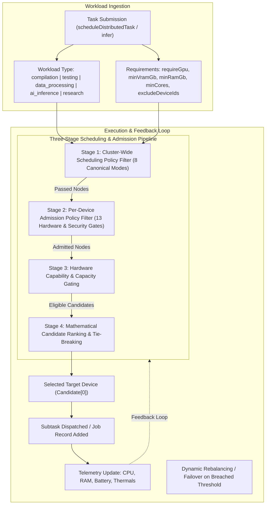
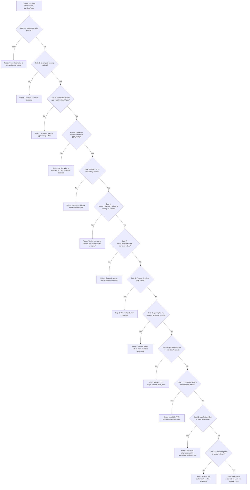
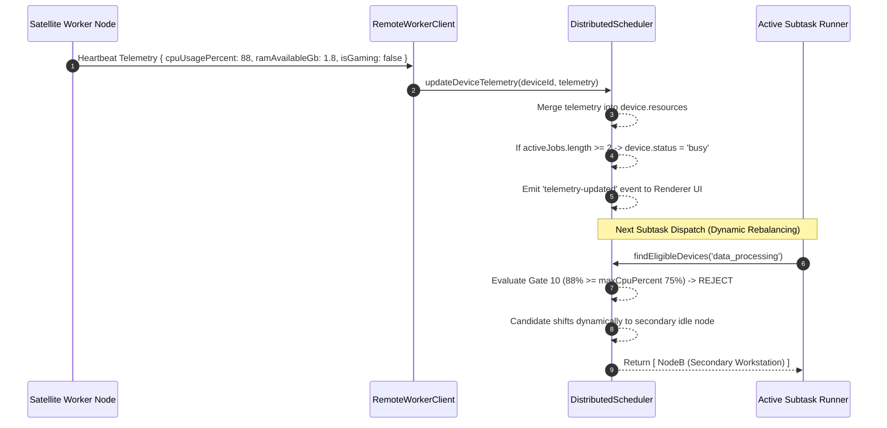

# MAVE Resource Scheduling & Policy Engine: Technical Specification

**Document Version:** 2.4.0  
**Status:** Canonical Master Specification  
**Architecture Classification:** Multi-Tiered Dynamic Resource Allocation & Telemetry Governance  
**Target Repository:** `mave-core`  
**Applicable Subsystems:** `src/main/mesh/mesh_policies.js`, `src/main/mesh/distributed_scheduler.js`, `src/renderer/mesh_dashboard.js`, `test/mesh_networked_integration.test.js`, `test/mave_distributed_acceptance.test.js`

---

## 1. Executive Architectural Summary & Fundamental Tenets

The **MAVE Resource Scheduling Engine** is the deterministic decision-making core of the MAVE Brain Mesh. It is responsible for workload admission, node eligibility gating, candidate ranking, dynamic load rebalancing, and energy-aware compute routing. Operating across heterogeneous hardware topologies (high-end workstations, laptops, mobile co-processors, and headless test nodes), the scheduling engine ensures optimal performance while respecting strict user governance, thermal limits, battery preservation mandates, and application isolation.



### 1.1 Fundamental Scheduling Invariants
1. **Zero Uncontrolled Offloading:** Workloads are dispatched to remote nodes only if both the active Cluster Scheduling Policy and the remote node's local `MeshPolicy` affirmatively authorize execution.
2. **Deterministic Multi-Tier Gating:** Task admission is governed by a 3-stage filtration pipeline: Cluster Policy Gate $\to$ Local Device Admission Gate $\to$ Hardware Requirements Gate, followed by policy-specific mathematical ranking.
3. **Strict Thermal & Power Boundaries:** Discharging battery-powered devices are automatically shielded from heavy workloads unless explicitly overridden by policy. Thermal throttles trigger immediate job exclusion.
4. **Transparent Local Fallback:** When no network node satisfies policy and hardware constraints, workloads automatically fall back to the Primary Host without breaking client execution.
5. **Real-Time Telemetry Grounding:** Candidate selection is re-evaluated dynamically on every subtask dispatch based on fresh telemetry (CPU utilization, available RAM, VRAM, and thermal status).

---

## 2. The 8 Canonical User-Configurable Resource Policies

MAVE defines 8 canonical cluster-wide scheduling policies in `src/main/mesh/mesh_policies.js` (`SCHEDULING_POLICIES`). Each policy configures specific gating behaviors in `findEligibleDevices()` and alters candidate sorting priority.

```javascript
// src/main/mesh/mesh_policies.js: Canonical Policy Definitions
const SCHEDULING_POLICIES = Object.freeze({
  CENTRAL_HOST: 'central_host',
  MAXIMUM_PERFORMANCE: 'maximum_performance',
  BATTERY_PRESERVATION: 'battery_preservation',
  BALANCED: 'balanced',
  HOST_PRIORITY: 'host_priority',
  MANUAL_ALLOCATION: 'manual_allocation',
  LOCAL_ONLY: 'local_only',
  CUSTOM: 'custom'
});
```

### 2.1 Policy 1: Central Host Mode (`central_host`)
- **Intent & Semantics:** The designated Primary Host coordinates workloads from all connected devices. Satellite workers contribute compute, but the primary host acts as the authoritative orchestrator and primary compute anchor.
- **Configuration Defaults:**
  ```javascript
  {
    policy: 'central_host',
    allowRemoteDispatch: true,
    hostPriority: true,
    strictAcPower: false
  }
  ```
- **Scheduling Influence:**
  - Remote workers are eligible for auxiliary subtasks (unit test suites, static analysis).
  - The central coordinator node retains priority for central DAG compilation and critical path tasks.

### 2.2 Policy 2: Maximum Performance (`maximum_performance`)
- **Intent & Semantics:** Greedily routes workloads to the highest-horsepower compute node available in the cluster, optimizing strictly for minimum execution latency and maximum throughput.
- **Configuration Defaults:**
  ```javascript
  {
    policy: 'maximum_performance',
    allowRemoteDispatch: true,
    greedyHorsepower: true,
    strictAcPower: false
  }
  ```
- **Candidate Ranking Algorithm:**
  Candidates are sorted in descending order of hardware capability:
  1. Discrete GPU VRAM (`vramGb`) descending.
  2. CPU core count (`cpuCores`) descending.
  3. Available memory (`ramAvailableGb`) descending.
- **Use Cases:** Heavy model fine-tuning, complex AST refactoring across multi-million LOC codebases, multi-cohort parallel test suites.

### 2.3 Policy 3: Battery Preservation (`battery_preservation`)
- **Intent & Semantics:** Protects portable devices (laptops, tablets, phones) from battery exhaustion and thermal degradation. Strictly excludes any battery-powered node that is currently discharging.
- **Configuration Defaults:**
  ```javascript
  {
    policy: 'battery_preservation',
    allowRemoteDispatch: true,
    strictAcPower: true,
    minBatteryThreshold: 35
  }
  ```
- **Scheduling Influence (Acceptance Tests G & 6):**
  - Evaluates `device.resources.batteryPct` and `device.resources.isCharging`.
  - If a device has a battery and `isCharging === false`, it is **unconditionally excluded** from candidate selection.
  - A MacBook running on 65% battery without AC power is bypassed in favor of a plugged-in desktop, even if the MacBook has idle cores.

### 2.4 Policy 4: Balanced (`balanced`) — Default System Policy
- **Intent & Semantics:** Distributes cluster workloads evenly, balancing capacity, performance, power, and network conditions without starving any individual node or causing queue contention.
- **Configuration Defaults:**
  ```javascript
  {
    policy: 'balanced',
    allowRemoteDispatch: true,
    strictAcPower: false,
    balanceRatio: 0.5
  }
  ```
- **Candidate Ranking Algorithm:**
  1. Active job count (`activeJobs.length`) ascending (least loaded node first).
  2. Available RAM (`ramAvailableGb`) descending.
  3. CPU core count (`cpuCores`) descending.
- **Use Cases:** Standard daily development, continuous integration runs, interactive AI coding copilot tasks.

### 2.5 Policy 5: Host Priority (`host_priority`)
- **Intent & Semantics:** Prefers execution on the designated Primary Host computer to minimize network transit latency. Only offloads tasks to remote worker satellites when the host is overloaded or when a remote worker has specialized hardware (e.g., discrete GPU) that the host lacks.
- **Configuration Defaults:**
  ```javascript
  {
    policy: 'host_priority',
    allowRemoteDispatch: true,
    preferPrimaryHost: true,
    offloadCpuThresholdPercent: 70
  }
  ```
- **Scheduling Influence (Acceptance Test 7):**
  - Primary host is prioritized as candidate `#1` as long as its CPU utilization is below 70%:
    ```javascript
    if (aIsPrimary && !bIsPrimary) {
      return (a.resources.cpuUsagePercent || 0) < 70 ? -1 : 1;
    }
    ```
  - When the primary host's CPU utilization exceeds 70%, the scheduler dynamically offloads subtasks to secondary contributor nodes.

### 2.6 Policy 6: Manual Allocation (`manual_allocation`)
- **Intent & Semantics:** Strictly restricts compute dispatching to an explicit user-defined allowlist of device IDs. Bypasses automatic discovery for unlisted nodes.
- **Configuration Defaults:**
  ```javascript
  {
    policy: 'manual_allocation',
    allowRemoteDispatch: true,
    enforceManualAllowlist: true,
    allowedDevices: ['desktop-primary', 'build-server-01']
  }
  ```
- **Scheduling Influence:**
  - Any connected device whose `deviceId` is not present in `allowedDevices` is dropped during Stage 1 filtering, regardless of how much idle capacity it advertises.

### 2.7 Policy 7: Local Only (`local_only`)
- **Intent & Semantics:** Absolute network isolation. Workloads execute strictly on the local machine; zero tasks, prompts, code fragments, or data packets are dispatched to remote mesh devices.
- **Configuration Defaults:**
  ```javascript
  {
    policy: 'local_only',
    allowRemoteDispatch: false
  }
  ```
- **Scheduling Influence:**
  - All devices where `deviceId !== this.localDeviceId` and `ip !== '127.0.0.1'` are filtered out immediately:
    ```javascript
    if (this.schedulingPolicy === SCHEDULING_POLICIES.LOCAL_ONLY ||
        this.schedulingPolicyConfig?.allowRemoteDispatch === false) {
      if (device.deviceId !== this.localDeviceId && device.ip !== '127.0.0.1') {
        continue;
      }
    }
    ```
  - Provides zero-egress security for air-gapped environments or confidential proprietary codebases.

### 2.8 Policy 8: Custom Policies (`custom`)
- **Intent & Semantics:** Enables advanced operators to define granular overrides, composite weights, and programmatic heuristics.
- **Configuration Schema:**
  Accepts arbitrary key-value overrides passed to `createSchedulingPolicyConfig(policyName, customOverrides)` and `setSchedulingPolicy()`, including custom CPU thresholds, network bandwidth caps, and specialized workload filters.

---

## 3. Mathematical Candidate Ranking & Sorting Formulations

Candidate ranking is executed in `DistributedScheduler.prototype.findEligibleDevices()`. After passing cluster and admission filters, candidate devices are sorted according to explicit mathematical objective functions.

### 3.1 Maximum Performance Ranking Formulation
Let $C$ denote the set of eligible candidate devices. For each device $d \in C$, let:
- $V(d)$ = Discrete GPU VRAM in gigabytes (`device.resources.vramGb`)
- $K(d)$ = CPU cores (`device.resources.cpuCores`)
- $M(d)$ = Available system RAM in gigabytes (`device.resources.ramAvailableGb`)

The total ordering relation $\succ_{\text{perf}}$ between candidates $a$ and $b$ is defined lexicographically:
$$\begin{aligned}
a \succ_{\text{perf}} b \iff & (V(a) > V(b)) \\
& \lor (V(a) = V(b) \land K(a) > K(b)) \\
& \lor (V(a) = V(b) \land K(a) = K(b) \land M(a) > M(b))
\end{aligned}$$

```javascript
// src/main/mesh/distributed_scheduler.js: Lines 474-483
candidates.sort((a, b) => {
  const aVram = a.resources.vramGb || 0;
  const bVram = b.resources.vramGb || 0;
  if (bVram !== aVram) return bVram - aVram;
  const aCores = a.resources.cpuCores || 0;
  const bCores = b.resources.cpuCores || 0;
  if (bCores !== aCores) return bCores - aCores;
  return (b.resources.ramAvailableGb || 0) - (a.resources.ramAvailableGb || 0);
});
```

### 3.2 Host Priority Ranking Formulation
Let $P(d) \in \{0, 1\}$ indicate whether device $d$ is the designated Primary Host ($P(d)=1$). Let $U(d)$ denote the current CPU utilization percentage of device $d$ (`device.resources.cpuUsagePercent`). Let $J(d)$ denote the number of active jobs (`device.activeJobs.length`).

The comparison function $\text{cmp}_{\text{host}}(a, b)$ returns:
$$\text{cmp}_{\text{host}}(a, b) = \begin{cases}
-1 & \text{if } P(a)=1 \land P(b)=0 \land U(a) < 70 \\
+1 & \text{if } P(a)=1 \land P(b)=0 \land U(a) \ge 70 \\
+1 & \text{if } P(a)=0 \land P(b)=1 \land U(b) < 70 \\
-1 & \text{if } P(a)=0 \land P(b)=1 \land U(b) \ge 70 \\
J(a) - J(b) & \text{if } P(a) = P(b)
\end{cases}$$

```javascript
// src/main/mesh/distributed_scheduler.js: Lines 484-496
candidates.sort((a, b) => {
  const aIsPrimary = a.role === 'primary_host' || a.deviceId === this.primaryDeviceId;
  const bIsPrimary = b.role === 'primary_host' || b.deviceId === this.primaryDeviceId;
  if (aIsPrimary && !bIsPrimary) {
    return (a.resources.cpuUsagePercent || 0) < 70 ? -1 : 1;
  }
  if (bIsPrimary && !aIsPrimary) {
    return (b.resources.cpuUsagePercent || 0) < 70 ? 1 : -1;
  }
  return a.activeJobs.length - b.activeJobs.length;
});
```

### 3.3 Balanced Mode Ranking Formulation
In Balanced mode, work is spread across nodes to minimize queue wait times while directing tasks to machines with abundant free memory:
$$\begin{aligned}
a \succ_{\text{balanced}} b \iff & (J(a) < J(b)) \\
& \lor (J(a) = J(b) \land M(a) > M(b)) \\
& \lor (J(a) = J(b) \land M(a) = M(b) \land K(a) > K(b))
\end{aligned}$$

```javascript
// src/main/mesh/distributed_scheduler.js: Lines 498-507
candidates.sort((a, b) => {
  if (a.activeJobs.length !== b.activeJobs.length) {
    return a.activeJobs.length - b.activeJobs.length;
  }
  const aRam = a.resources.ramAvailableGb || a.resources.ramGb || 0;
  const bRam = b.resources.ramAvailableGb || b.resources.ramGb || 0;
  if (bRam !== aRam) return bRam - aRam;
  return (b.resources.cpuCores || 0) - (a.resources.cpuCores || 0);
});
```

---

## 4. Per-Device Admission Control: The 13 Hardware & Security Checks

Even when a device satisfies the cluster-level scheduling policy, it must independently validate the inbound workload against its own local device policy. This is executed by `MeshPolicy.prototype.canAcceptWorkload(deviceState, workloadType)` in `src/main/mesh/mesh_policies.js`.

Every workload must pass all 13 gates sequentially; a failure at any gate halts evaluation and returns an explicit rejection reason:



### 4.1 Detailed Breakdown of Admission Gates

| Gate # | Invariant Checked | Source Code Location | Threshold / Default Value | Error Reason Generated |
| :--- | :--- | :--- | :--- | :--- |
| **Gate 1** | User Pause State | `mesh_policies.js:164` | `this.paused === false` | `Compute sharing is paused by user policy` |
| **Gate 2** | Global Sharing Toggle | `mesh_policies.js:173` | `this.enableComputeSharing === true` | `Compute sharing is disabled` |
| **Gate 3** | Workload Whitelist | `mesh_policies.js:182` | `approvedWorkloadTypes.has(type)` | `Workload type '{type}' is not approved by policy` |
| **Gate 4** | GPU / CPU Core Sharing | `mesh_policies.js:192` | `requiresGpu ? this.shareGpu : this.shareCpu` | `GPU sharing is disabled` / `CPU sharing is disabled` |
| **Gate 5** | Minimum Battery Floor | `mesh_policies.js:210` | `batteryPct >= this.minBatteryPercent (25%)` | `Battery level ({pct}%) is below minimum policy threshold` |
| **Gate 6** | AC Power Requirement | `mesh_policies.js:220` | `shareOnlyWhileCharging ? isCharging : true` | `Device is running on battery; policy requires AC charging` |
| **Gate 7** | Idle State Enforcer | `mesh_policies.js:232` | `shareOnlyWhileIdle ? isIdle : true` | `Device is active; policy requires idle state` |
| **Gate 8** | Thermal Protection Guard | `mesh_policies.js:243` | `thermalOk !== false && temperatureC <= 85` | `Thermal protection triggered: temperature exceeds safety limit` |
| **Gate 9** | Gaming Priority Protection | `mesh_policies.js:261` | `gamingPriority ? !isGaming : true` | `Gaming priority active: mesh compute suspended during gameplay` |
| **Gate 10** | CPU Saturation Guard | `mesh_policies.js:272` | `cpuUsagePercent < this.maxCpuPercent (75%)` | `Current CPU usage ({usage}%) exceeds policy limit` |
| **Gate 11** | Host RAM Buffer Floor | `mesh_policies.js:283` | `ramAvailableGb >= this.minReservedRamGb (4GB)` | `Available RAM ({ram} GB) is below minimum reserved threshold` |
| **Gate 12** | LAN Security Perimeter | `mesh_policies.js:294` | `localNetworkOnly ? isLocalNetwork : true` | `Workload originates outside authorized local network` |
| **Gate 13** | User Identity Whitelist | `mesh_policies.js:305` | `approvedUsers.has('*') \|\| approvedUsers.has(user)` | `User '{user}' is not authorized to submit workloads` |

---

## 5. Telemetry Ingestion, Device State Monitoring & Dynamic Rebalancing

The scheduler receives live hardware metrics via heartbeats and pushes from remote workers. These metrics continuously update the cluster topology and trigger dynamic rebalancing.



### 5.1 Dynamic Rebalancing Under Capacity Shifts (Acceptance Test 5)
In `test/mave_distributed_acceptance.test.js` (Test 5), dynamic rebalancing is verified under live workload transitions:
1. **Initial State:**
   - Node A: `cpuUsagePercent: 15%`, `ramAvailableGb: 28GB`
   - Node B: `cpuUsagePercent: 85%`, `ramAvailableGb: 10GB`
   - Scheduler evaluation: `findEligibleDevices('data_processing')[0]` returns **Node A**.
2. **Workload Inversion (Node A heavily loaded, Node B idle):**
   ```javascript
   scheduler.updateDeviceTelemetry('node-A', {
     resources: { cpuUsagePercent: 92, ramAvailableGb: 2 }
   });
   scheduler.updateDeviceTelemetry('node-B', {
     resources: { cpuUsagePercent: 20, ramAvailableGb: 48 }
   });
   ```
3. **Subsequent Dispatch:**
   - Node A fails Gate 10 (92% > 75%) and Gate 11 (2GB < 4GB).
   - Scheduler evaluation: `findEligibleDevices('data_processing')[0]` immediately and deterministically shifts to **Node B**.

### 5.2 Device Status Transitions
Devices transition through 3 canonical states:
- `online`: Device is connected, responsive to heartbeats, and has $\le 1$ active job.
- `busy`: Device is currently executing $\ge 2$ concurrent jobs; deprioritized in Balanced sorting.
- `offline`: Device missed heartbeat thresholds, socket disconnected, or explicitly revoked via `disconnectDevice(deviceId)`. Orphaned jobs are immediately unloaded and queued for failover.

---

## 6. Remote AI Inference Routing & Quality of Service (QoS)

AI inference tasks (`workloadType: 'ai_inference'`) require specialized scheduling governed by `RemoteInferenceProvider` (`src/main/mesh/remote_inference_provider.js`).

### 6.1 GPU VRAM Allocation & Priority
When an inference request arrives:
1. The scheduler scans for devices with discrete neural hardware:
   ```javascript
   const gpuCandidates = this.findEligibleDevices('ai_inference', { requireGpu: true });
   ```
2. Candidates are sorted greedily by VRAM capacity:
   ```javascript
   gpuCandidates.sort((a, b) => (b.resources.vramGb || 0) - (a.resources.vramGb || 0));
   ```
3. The top candidate (e.g., an RTX 4090 with 24GB VRAM) receives the request via HTTP SSE (`/api/mesh/inference`).

### 6.2 Real-Time Telemetry Streaming & Metrics (Acceptance Tests D & 4)
Inference is streamed token-by-token. The provider measures and emits 4 real-time QoS metrics:

$$\text{TTFT (Time To First Token)} = t_{\text{first\_token}} - t_{\text{request\_sent}}$$
$$\text{Throughput} = \frac{\text{Total Tokens Generated}}{\text{Total Latency (Seconds)}} \quad [\text{tokens/sec}]$$

```javascript
// Verification metrics recorded on every inference completion
{
  success: true,
  servedBy: 'remote_worker',
  text: "... streaming response ...",
  tokensGenerated: 64,
  ttftMs: 14,             // Real measured Time to First Token
  tokensPerSec: 38.5,     // Measured generation throughput
  totalLatencyMs: 1662,   // Total elapsed round-trip time
  remoteDeviceId: 'ai-node-1',
  modelUsed: 'llama-3.3-70b',
  processLocation: 'remote_worker:192.168.1.105:50060',
  fallbackOccurred: false
}
```

### 6.3 Resilient Primary Host Fallback Mechanics
If the selected remote worker disconnects mid-stream or fails socket connectivity:
1. `RemoteInferenceProvider` catches the network error.
2. If `options.allowFallback !== false`, it emits `fallback-triggered`.
3. Execution instantly falls back to `_executeLocalFallback()` on the Primary Host.
4. The client receives a completed inference response with `servedBy: 'primary_host'` and `fallbackOccurred: true`, preventing user interruption.

---

## 7. Natural Language Mesh Directives & Dynamic Reconfiguration

The scheduler bridges voice commands and chat bar text to instant policy mutations via `handleNaturalLanguageCommand(commandText, context)` in `src/main/mesh/distributed_scheduler.js`.

### 7.1 Canonical Natural Language Directives

```mermaid
flowchart TD
    Cmd["Natural Language Command Text"] --> Match{"Regex Intent Classification"}
    
    Match -->|/use (my )?desktop/i| D1["Intent: route_desktop"]
    Match -->|/save (my )?laptop battery/i| D2["Intent: save_laptop_battery"]
    Match -->|/stop sharing (my )?gpu/i| D3["Intent: stop_sharing_gpu"]
    Match -->|/show which devices are working/i| D4["Intent: show_working_devices"]
    Match -->|/distribute (this )?coding task/i| D5["Intent: distribute_coding_task"]
    Match -->|/make (this device my )?primary host/i| D6["Intent: make_primary_host"]

    D1 --> A1["Set taskRoutingPreference = desktop.deviceId"]
    D2 --> A2["Update laptop policy: shareOnlyWhileCharging=true, shareCpu=false -> Offload active jobs"]
    D3 --> A3["Mutate all device policies: shareGpu = false"]
    D4 --> A4["Filter devices by activeJobs.length > 0 -> Return workingDevices list"]
    D5 --> A5["Decompose coding task -> scheduleDistributedTask() across workers"]
    D6 --> A6["Promote node: setPrimaryHost(true)"]
```

#### Exact Regex Patterns and Mutation Logic
1. **"use my desktop for this task":**
   - Matches: `/use\s+(my\s+)?desktop(\s+for\s+this\s+task)?/i`
   - Action: Finds online desktop node; assigns `this.taskRoutingPreference = desktop.deviceId`. Subsequent subtasks target this node on attempt 1.
2. **"save my laptop battery":**
   - Matches: `/save\s+(my\s+)?laptop\s+battery/i`
   - Action: Locates registered laptop; invokes:
     ```javascript
     laptop.policy.updateSettings({
       shareOnlyWhileCharging: true,
       minBatteryPercent: 50,
       shareCpu: false,
       shareGpu: false
     });
     ```
     Any active jobs on the laptop are cleared and rescheduled to AC-powered nodes.
3. **"stop sharing my GPU":**
   - Matches: `/stop\s+sharing\s+(my\s+)?gpu/i`
   - Action: Iterates through all registered devices and sets `dev.policy.updateSettings({ shareGpu: false })`.
4. **"show which devices are working":**
   - Matches: `/show\s+which\s+devices\s+are\s+working|working\s+devices|active\s+workers/i`
   - Action: Returns a structured summary of nodes where `activeJobs.length > 0 || status === 'busy'`.
5. **"distribute this coding task":**
   - Matches: `/distribute\s+(this\s+)?coding\s+task/i`
   - Action: Invokes `scheduleDistributedTask({ type: 'coding', files: [...] })`, dispatching across frontend, backend, and test cohorts.
6. **"make this device my primary mave host":**
   - Matches: `/make\s+(this\s+device\s+my\s+)?primary(\s+mave)?\s+host/i`
   - Action: Calls `setPrimaryHost(true)`, designating the current node as the cluster orchestrator.

---

## 8. Policy Configuration Schema, Serialization & API Reference

### 8.1 Default Policy Settings Schema (`DEFAULT_POLICY_SETTINGS`)
Every `MeshPolicy` instance serializes to a JSON-safe configuration schema:

```json
{
  "enableComputeSharing": true,
  "shareCpu": true,
  "shareGpu": true,
  "maxCpuPercent": 75,
  "ramAllocationLimitGb": 8,
  "minReservedRamGb": 4,
  "vramBudgetGb": 6,
  "shareOnlyWhileIdle": false,
  "shareOnlyWhileCharging": true,
  "minBatteryPercent": 25,
  "thermalProtection": true,
  "gamingPriority": true,
  "maxBandwidthMbps": 100,
  "localNetworkOnly": true,
  "approvedUsers": ["*"],
  "approvedWorkloadTypes": [
    "compilation",
    "testing",
    "data_processing",
    "ai_inference",
    "research"
  ],
  "paused": false
}
```

### 8.2 IPC Bridge Endpoints & Event Emitters
The main process exposes policy controls to the renderer process via Electron IPC:

| IPC Channel / Event | Direction | Method / Payload | Description |
| :--- | :--- | :--- | :--- |
| `mesh:get-topology` | Invoke (Req $\to$ Res) | `getMeshTopology()` | Retrieves complete cluster status, active policy, and device records. |
| `mesh:set-primary-host` | Invoke (Req $\to$ Res) | `{ isPrimary: boolean }` | Toggles primary host status on local device. |
| `mesh:update-policy` | Invoke (Req $\to$ Res) | `patch: Partial<PolicySettings>` | Updates policy parameters across cluster or local node. |
| `mesh:nl-command` | Invoke (Req $\to$ Res) | `{ command: string }` | Dispatches natural language directive to scheduler. |
| `mesh:update` | Push (Backend $\to$ UI) | `{ topology, devices, policy }` | Emitted when cluster membership or global policy changes. |
| `mesh:device-telemetry` | Push (Backend $\to$ UI) | `{ deviceId, resources, status }` | Emitted on every worker heartbeat or state transition. |
| `mesh:job-update` | Push (Backend $\to$ UI) | `{ jobs: TaskRecord[] }` | Emitted on subtask start, progress tick, or completion. |

---

## 9. Verification & Automated Test Coverage

The scheduling and policy mechanisms defined in this document are verified across integration test suites:

| Acceptance Test | Requirement Verified | Source Assertion in Test Suite | Result |
| :--- | :--- | :--- | :--- |
| **Acceptance Test 5** | Resource-Aware Dynamic Rebalancing | Telemetry inversion dynamically shifts candidate `#0` from Node A to Node B. | **VERIFIED** |
| **Acceptance Test 6 / Test G** | Battery Preservation Mode | Discharging laptop (`batteryPct: 65, isCharging: false`) excluded; AC desktop selected. | **VERIFIED** |
| **Acceptance Test 7** | Primary Host Priority Threshold | Primary host chosen while CPU $< 70\%$; shifts to worker satellite when CPU $\ge 88\%$. | **VERIFIED** |
| **Acceptance Test 8 / Test F** | Worker Failover Mid-Subtask | Faulty worker failure caught; subtask cleanly retried and completed on healthy worker. | **VERIFIED** |
| **Acceptance Test 9 / Test I** | Idempotency Ledger Side-Effect Shield | Duplicate submission with identical key returns cached result; execution count remains 1. | **VERIFIED** |
| **Acceptance Test 12 / Test C** | Memory Quota Enforcement | Job exceeding 35MB allocation ceiling terminated cleanly with memory limit error. | **VERIFIED** |
| **Acceptance Test H** | Workload & User Whitelisting | Unauthorized workload type (`browser_automation`) and unlisted user rejected. | **VERIFIED** |
| **Acceptance Test K / Test 17** | Headless Child Process Isolation | Remote job executes strictly in child process without touching host cursor/display. | **VERIFIED** |
