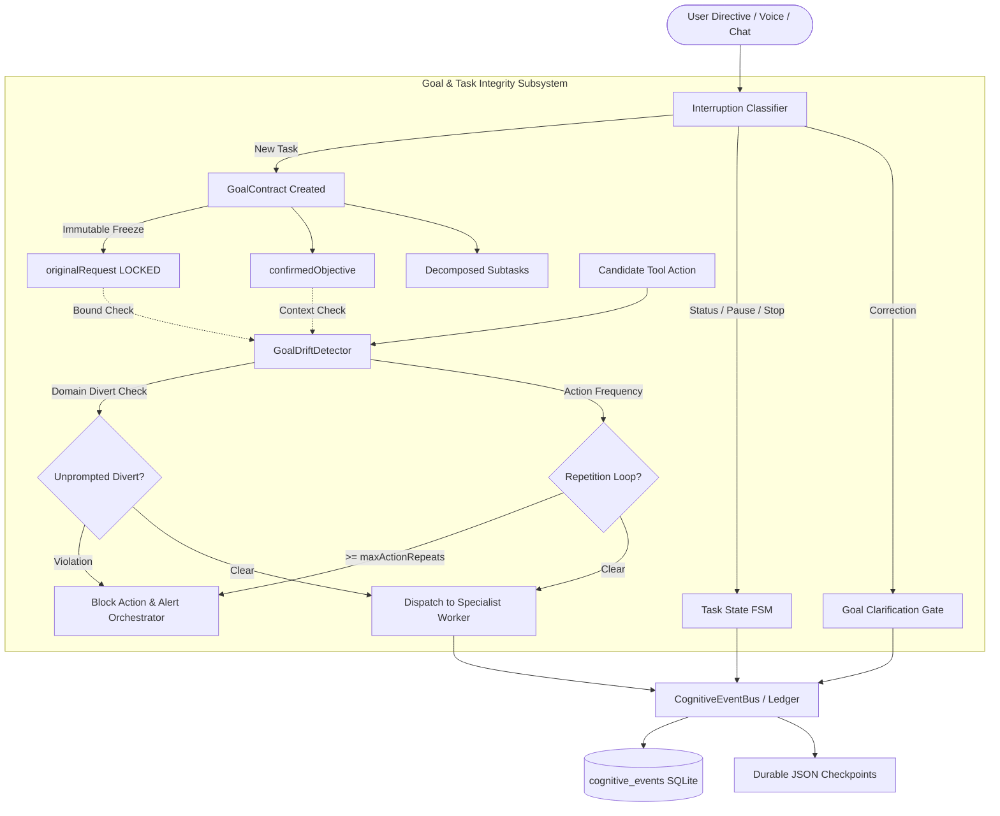
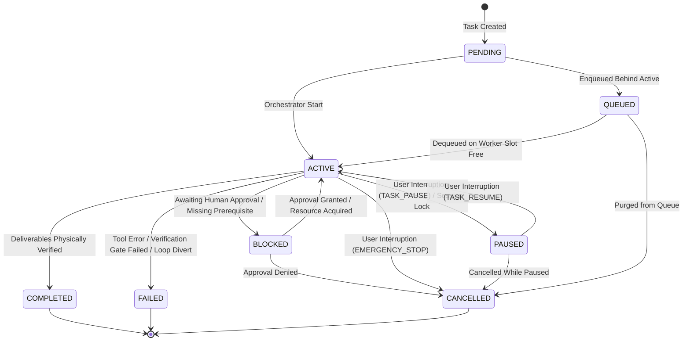
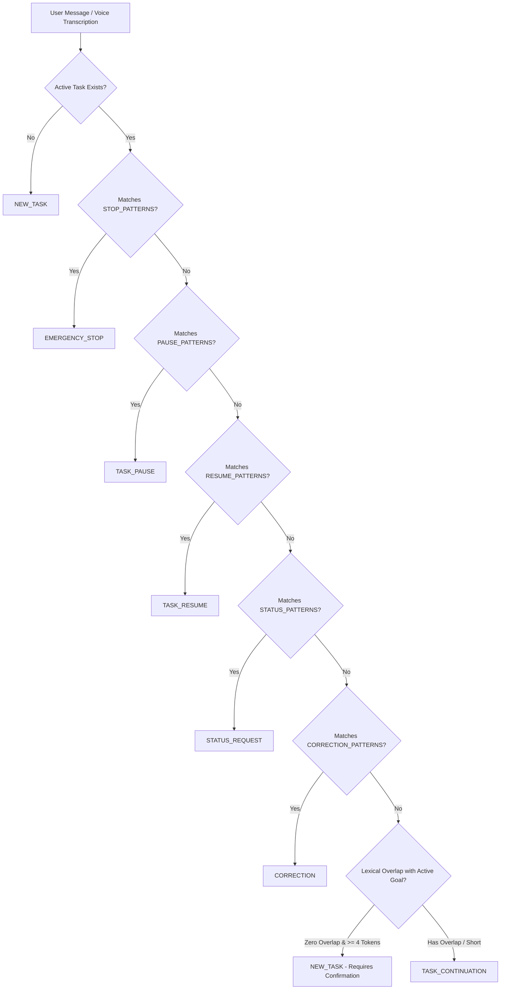
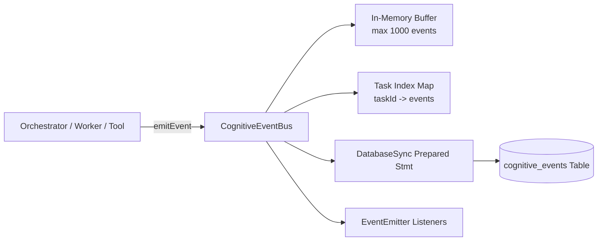

# MAVE Task Integrity Design: GoalContract, Drift Detection & Event Ledger

**Author:** Principal Memory Systems Architect  
**Subsystem:** MAVE Autonomous Orchestration Engine (`src/main/orchestrator`)  
**Status:** Canonical Engineering Specification  
**Invariants Enforced:** Gravitas Grounding, State Boundary Rigor, Zero Drift Guarantee  

---

## 1. Executive Summary & Purpose

Autonomous AI agents routinely fail in multi-turn desktop environments due to three compounding vulnerabilities:
1. **Goal Drift:** Incremental diversion from the original user directive caused by chain-of-thought hallucination, rabbit-hole problem solving, or unprompted entertainment detours (e.g., wandering to social media while seeking coding documentation).
2. **State Boundary Confusion:** Uncontrolled state transitions where incoming conversational utterances (status queries, side clarifications, or interruptions) inadvertently overwrite in-flight goal definitions or reset active subtasks.
3. **Execution Amnesia & Action Loops:** Inability to detect repetitive failing tool executions, lack of durable checkpoints across crashes or process reboots, and absent audit ledgers.

MAVE resolves these failure modes through a triad of deterministic orchestration constructs:
- **`GoalContract`** (`src/main/orchestrator/goal_contract.js`): An immutable, frozen specification of the user's primary objective with explicit deliverable conditions and finite state boundaries.
- **`GoalDriftDetector`** (`src/main/orchestrator/goal_drift_detector.js`): An active policy enforcement engine that classifies candidate actions and incoming messages, intercepting unprompted diversions and repetitive loops.
- **`TaskEventLedger` / `CognitiveEventBus`** (`src/main/orchestrator/cognitive_event_bus.js`): An append-only, durable event ledger recording all lifecycle events, correlations, and checkpoints with transactional SQLite persistence.



---

## 2. Core Architectural Invariants

### Invariant 1: Primary Goal Locking (`originalRequest` Immutability)
When a task is initialized, the raw, unedited user directive is stamped onto `originalRequest` and permanently locked via `Object.freeze`:
```javascript
// src/main/orchestrator/goal_contract.js
this.originalRequest = Object.freeze(String(spec.originalRequest).trim());
```
Under no circumstances may any internal subtask, downstream LLM re-prompting, or heuristic summarizer alter `originalRequest`. While `confirmedObjective` and `expectedDeliverables` may be updated via `clarifyObjective()`, the audit root remains permanently anchored to the user's original words.

### Invariant 2: Discrete State Boundaries & FSM Enforcement
A task must occupy exactly one status at any millisecond of its lifecycle. Status mutations are strictly guarded against invalid transitions. Calling `setStatus()` validates against the finite enumeration `TaskStatus` and records an audited `STATUS_CHANGE` entry in the execution history.

### Invariant 3: Zero Autonomous Goal Alteration
The system cannot autonomously replace an active goal with a new one. When a user issues a new directive while a goal is `ACTIVE`, the orchestrator must either:
- Queue the new directive as `QUEUED` without disturbing the active task; or
- Prompt for explicit confirmation before switching active goals.

---

## 3. GoalContract Deep Dive

### 3.1 Data Model & Class Specification
`GoalContract` encapsulates the end-to-end contract between the user and the cognitive runtime.

```javascript
// Data shape of GoalContract (JSDoc definition)
/**
 * @typedef {Object} GoalContractSpec
 * @property {string} [taskId] - Unique deterministic task identifier (`task_${timestamp}_${hex}`)
 * @property {string} [userId='default'] - Tenant / user identity
 * @property {string} [sessionId] - Active conversational session identifier
 * @property {string} originalRequest - Immutable user prompt/directive
 * @property {string} [confirmedObjective] - Structured objective formulation
 * @property {string[]} [expectedDeliverables=[]] - Expected physical artifacts or outcomes
 * @property {object} [scope={}] - Allowed tools, target paths, boundaries
 * @property {object} [constraints={}] - Privacy, offline-only, token budgets
 * @property {string[]} [approvalRequirements=[]] - High-impact operations needing confirmation
 * @property {object[]} [completionConditions=[]] - Verifiable acceptance tests
 * @property {string} [status='pending'] - Current lifecycle state
 * @property {string} [currentPhase='initialization'] - Active execution sub-phase
 */
```

### 3.2 Property Breakdown

| Property | Type | Mutability | Purpose |
| :--- | :--- | :--- | :--- |
| `taskId` | `string` | Read-only | Globally unique identifier for correlation across logs, checkpoints, and DB |
| `userId` | `string` | Read-only | Multi-tenant isolation partition key |
| `sessionId` | `string` | Read-only | Conversation session context boundary |
| `originalRequest` | `string` | **Frozen** | Verbatim raw user instruction; never modified |
| `confirmedObjective`| `string` | Mutable (guarded) | Synthesized, actionable formulation of the goal |
| `expectedDeliverables`| `string[]`| Append-only | Expected concrete files, reports, or test outcomes |
| `scope` | `object` | Mutable (guarded) | Whitelist of allowed tools, target directories, network endpoints |
| `constraints` | `object` | Mutable (guarded) | Execution rules (e.g., `offlineOnly: true`, `maxTokens: 4096`) |
| `approvalRequirements`| `string[]`| Mutable | Operations requiring interactive human-in-the-loop sign-off |
| `completionConditions`| `object[]`| Mutable | Discrete assertions that must pass for `COMPLETED` status |
| `status` | `TaskStatus`| Guarded FSM | Finite state machine status |
| `currentPhase` | `string` | Guarded | Granular phase (e.g., `planning`, `executing_coding_specialist`) |
| `activeWorkers` | `Map` | Dynamic | Map of `workerId -> workerMeta` currently executing subtasks |
| `subtasks` | `Array` | Guarded | Decomposed hierarchical task units |
| `executionHistory` | `Array` | Append-only (cap 500) | In-memory circular event buffer for rapid auditing |
| `checkpoints` | `Array` | Append-only | Snapshot array for crash recovery |
| `verificationResults`| `object` | Post-execution | Concrete physical verification evidence (files on disk, tool outputs) |

### 3.3 Goal Clarification Protocol
When a user provides additional information or corrections mid-flight, the contract is updated via `clarifyObjective`:

```javascript
clarifyObjective(newObjective, addedDeliverables = [], reason = 'User clarification') {
  if (newObjective) {
    this.confirmedObjective = String(newObjective).trim();
  }
  if (Array.isArray(addedDeliverables)) {
    for (const d of addedDeliverables) {
      if (!this.expectedDeliverables.includes(d)) {
        this.expectedDeliverables.push(d);
      }
    }
  }
  this.updatedAt = Date.now();
  this.recordHistory('CLARIFICATION', { reason, newObjective, addedDeliverables });
}
```
Notice: `this.originalRequest` is untouched. The clarification is audited with a timestamped `CLARIFICATION` event.

---

## 4. Task State Boundaries & Lifecycle FSM

MAVE enforces 8 strict task states defined in `TaskStatus`:

```javascript
const TaskStatus = {
  PENDING: 'pending',     // Created, awaiting orchestrator scheduling or prerequisites
  ACTIVE: 'active',       // Currently executing through cognitive loop or specialist worker
  PAUSED: 'paused',       // Temporarily suspended by user interruption or lock guard
  QUEUED: 'queued',       // Stored in task queue awaiting active task completion
  COMPLETED: 'completed', // All completion conditions verified with physical proof
  CANCELLED: 'cancelled', // Aborted by user command (EMERGENCY_STOP) or operator override
  BLOCKED: 'blocked',     // Waiting on external dependencies, human approval, or lock
  FAILED: 'failed',       // Unrecoverable execution error or failed verification gate
};
```

### 4.1 State Transition Matrix



### 4.2 Transition Invariants
1. **Terminal States Are Final:** `COMPLETED`, `FAILED`, and `CANCELLED` cannot transition to any other state. If a user wishes to rerun or retry, a **new** `GoalContract` is constructed with a new `taskId` and a correlation link to the prior contract.
2. **Verification Gate Mandatory Before `COMPLETED`:** No task can transition from `ACTIVE` to `COMPLETED` without passing the acceptance verification gate. For coding tasks, deliverables must physically exist on the filesystem (`allExist === true`).
3. **Automatic Timestamping:** Reaching a terminal state automatically stamps `completedAt = Date.now()`.

---

## 5. User Interruption Classification

Incoming user speech or chat during an ongoing task is classified into 7 discrete categories by `GoalDriftDetector.classifyUserMessage()` before the orchestrator touches state.

### 5.1 Interruption Taxonomy



### 5.2 Deterministic Pattern Matchers

```javascript
// Compiled Regex Invariants (src/main/orchestrator/goal_drift_detector.js)
const STATUS_PATTERNS = /\b(?:how(?:'s| is) it going|what are you doing|current status|what(?:'s| is) the progress|status update|where are you at|are you done yet|show progress)\b/i;
const CORRECTION_PATTERNS = /\b(?:actually|instead|rather|correction|change (?:the|that|it)|make it|switch to|use \w+ instead|don't use|fix (?:the|that))\b/i;
const PAUSE_PATTERNS = /\b(?:pause(?: for now)?|hold on|wait(?: a sec(?:ond)?)?|freeze|take a break|stop for a second)\b/i;
const RESUME_PATTERNS = /\b(?:continue|resume|keep going|proceed|go ahead|carry on)\b/i;
const STOP_PATTERNS = /\b(?:stop|cancel(?: the task)?|abort|terminate|halt|kill (?:the )?task)\b/i;
```

### 5.3 Behavioral Responses by Category

| Interruption Category | Orchestrator Action | Task State Change | User Response |
| :--- | :--- | :--- | :--- |
| `STATUS_REQUEST` | Queries active goal status & remaining subtasks | **None** (remains `ACTIVE`) | Returns progress summary without pausing workers |
| `CORRECTION` | Invokes `clarifyObjective()`, records event | Remains `ACTIVE` (adapted parameters) | Confirms adjustment and continues execution |
| `TASK_PAUSE` | Pauses running workers, saves checkpoint | `ACTIVE -> PAUSED` | "Paused [objective]. Say 'continue' whenever you're ready." |
| `TASK_RESUME` | Resumes workers from last checkpoint | `PAUSED -> ACTIVE` | "Resumed [objective]. Continuing execution." |
| `EMERGENCY_STOP` | Aborts child processes, kills worker threads | `ACTIVE -> CANCELLED` | "Cancelled task [objective]." Clears `activeTask` |
| `NEW_TASK` | Enqueues contract into `taskQueue` | **None** (remains `ACTIVE`) | "Saved new request as queued task. Will finish current first." |
| `TASK_CONTINUATION` | Feeds utterance to active worker context | Remains `ACTIVE` | Continues workflow |

---

## 6. GoalDriftDetector Deep Dive

`GoalDriftDetector` guards against two forms of execution degradation:
1. **Unrequested Entertainment / Social Divert**
2. **Tool Repetition Loops**

### 6.1 Entertainment / Social Divert Guard
When an autonomous agent has access to web browsing or application launch tools (`open_url`, `open_app`, `use_browser`), it can drift toward high-engagement consumer websites if search results mention them.

MAVE maintains an explicit domain guard list:
```javascript
const UNREQUESTED_DIVERT_DOMAINS = [
  { name: 'Instagram', regex: /\b(?:instagram\.com|instagram|insta)\b/i },
  { name: 'TikTok', regex: /\b(?:tiktok\.com|tiktok)\b/i },
  { name: 'YouTube', regex: /\b(?:youtube\.com|youtu\.be)\b/i },
  { name: 'Netflix', regex: /\b(?:netflix\.com|netflix)\b/i },
  { name: 'Twitter/X', regex: /\b(?:twitter\.com|x\.com)\b/i },
  { name: 'Reddit', regex: /\b(?:reddit\.com|reddit)\b/i },
  { name: 'Twitch', regex: /\b(?:twitch\.tv|twitch)\b/i },
  { name: 'Facebook', regex: /\b(?:facebook\.com|fb\.com)\b/i },
];
```

#### Evaluation Logic:
Before dispatching any candidate tool action:
1. The detector inspects `action.args.url` or `action.args.name`.
2. If the target matches a divert domain, it cross-references the combined context (`originalRequest + confirmedObjective`).
3. **If the user explicitly asked for that domain** (e.g., "Find the latest video on YouTube regarding Vulkan drivers"), the action is **allowed**.
4. **If the domain was NOT in the user directive**, the action is **hard blocked**:
   ```javascript
   return {
     allowed: false,
     reason: `Unrequested diversion to ${divert.name}. The user's active task is "${goalContract.originalRequest}".`,
     divertType: 'ENTERTAINMENT_DISTRACTION',
   };
   ```

### 6.2 Repetition Loop Detection
A frequent autonomous failure is the "retry storm"—calling the same tool with identical failing arguments multiple times (e.g., repeatedly trying to read a missing file or failing to parse a specific selector).

```javascript
// src/main/orchestrator/goal_drift_detector.js
const actionKey = `${tool}:${JSON.stringify(args)}`;
const recentIdentical = this.actionHistory.slice(-4).filter((h) => h.key === actionKey);
if (recentIdentical.length >= this.maxActionRepeats) {
  return {
    allowed: false,
    reason: `Repetition loop detected: Action "${tool}" with identical arguments was attempted ${recentIdentical.length} times without progress.`,
    divertType: 'REPETITION_LOOP',
  };
}
```
- Default threshold: `maxActionRepeats = 2`.
- When triggered, execution is blocked immediately, preventing token exhaustion and API hammering. The orchestrator is notified to invoke reflection or fail the subtask gracefully.

---

## 7. TaskEventLedger & CognitiveEventBus

`CognitiveEventBus` (`src/main/orchestrator/cognitive_event_bus.js`) serves as the immutable audit ledger for all cognitive activity in MAVE.

### 7.1 Architecture & Dual-Write Pattern
Events are handled via a high-performance dual-write pattern:
1. **In-Memory Ring Buffer:** Stored in `this.events` (bounded to 1,000 entries) and indexed by `taskId` in `this.taskIndex` (bounded to 200 per task) for zero-latency retrieval during active loops.
2. **Transactional SQLite Persistence:** Flushed synchronously to the `cognitive_events` table via `node:sqlite` `DatabaseSync`.



### 7.2 Standard Event Types
Defined in `CognitiveEventTypes`:
- **Lifecycle:** `TASK_CREATED`, `TASK_UPDATED`, `TASK_PAUSED`, `TASK_RESUMED`, `TASK_COMPLETED`, `TASK_FAILED`, `TASK_BLOCKED`, `TASK_CANCELLED`
- **Tooling:** `TOOL_STARTED`, `TOOL_COMPLETED`, `TOOL_FAILED`
- **Workers:** `WORKER_ASSIGNED`, `WORKER_COMPLETED`
- **Memory & Context:** `MEMORY_WRITTEN`, `MEMORY_RETRIEVED`, `VISUAL_OBSERVATION`
- **Governance:** `USER_INTERRUPTION`, `APPROVAL_REQUIRED`, `GOAL_DRIFT_DETECTED`, `VERIFICATION_COMPLETED`, `FINAL_RESPONSE_DELIVERED`

---

## 8. Persistent Task Checkpoints & Crash Recovery

### 8.1 Checkpoint Structure
Checkpoints capture the exact minimal state required to resurrect a task after an unexpected OS reboot, process termination, or crash:

```javascript
// Checkpoint schema produced by saveCheckpoint()
{
  "checkpointId": "cp_1730376120000_1",
  "timestamp": 1730376120000,
  "taskId": "task_1730376000000_a1b2c3d4",
  "status": "active",
  "currentPhase": "executing_coding_specialist",
  "subtasks": [
    { "id": "sub_1", "title": "Scaffold HTML", "status": "completed", "deliverable": "index.html" },
    { "id": "sub_2", "title": "Implement CSS", "status": "in_progress", "deliverable": "styles.css" }
  ],
  "expectedDeliverables": ["index.html", "styles.css", "app.js"]
}
```

### 8.2 Recovery Workflow
1. **Startup Scan:** On application boot, `MaveCognitiveOrchestrator` scans the checkpoint directory (`%APPDATA%/mave/checkpoints/` or local workspace).
2. **Orphan Detection:** Any checkpoint with status `active` or `paused` whose process ID has expired is identified as an interrupted task.
3. **Hydration via `GoalContract.fromJSON()`:** The contract is fully reconstituted. Completed subtasks are preserved; incomplete subtasks are scheduled for resumption.
4. **User Notification:** MAVE prompts the user:
   > *"I noticed an interrupted task from your prior session: 'Create responsive landing page'. 1 of 2 subtasks were completed. Would you like me to resume?"*

---

## 9. Concrete Runtime Verification & Evidence

The task integrity subsystem is verified through automated unit and integration suites:
- **State Boundary Tests:** Verify that direct status assignments adhere to `TaskStatus` and record auditable transitions.
- **Drift Evaluation Tests:** Verify that attempts to open unrequested social domains return `allowed: false` with `ENTERTAINMENT_DISTRACTION`, while requested domains pass.
- **Loop Interception Tests:** Verify that repeated actions trigger `REPETITION_LOOP` on the Nth identical invocation.
- **Interruption Classification Tests:** Verify that stop, pause, resume, status, correction, and new task strings are accurately resolved.

This contract provides an unbreakable guarantee of execution integrity for the MAVE cognitive engine.
